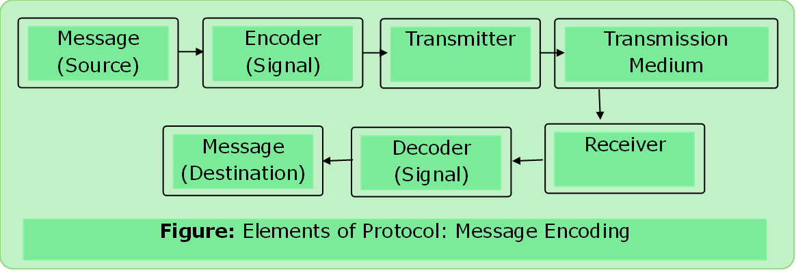
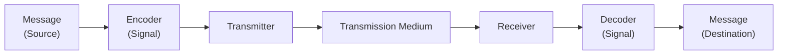
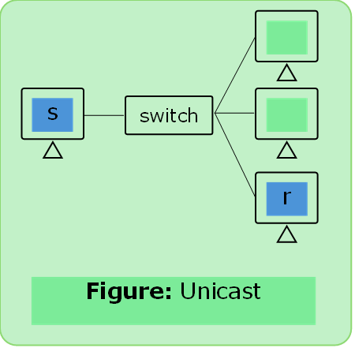
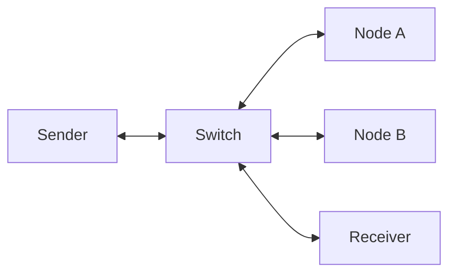
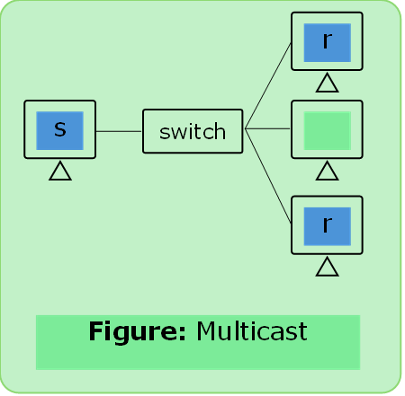
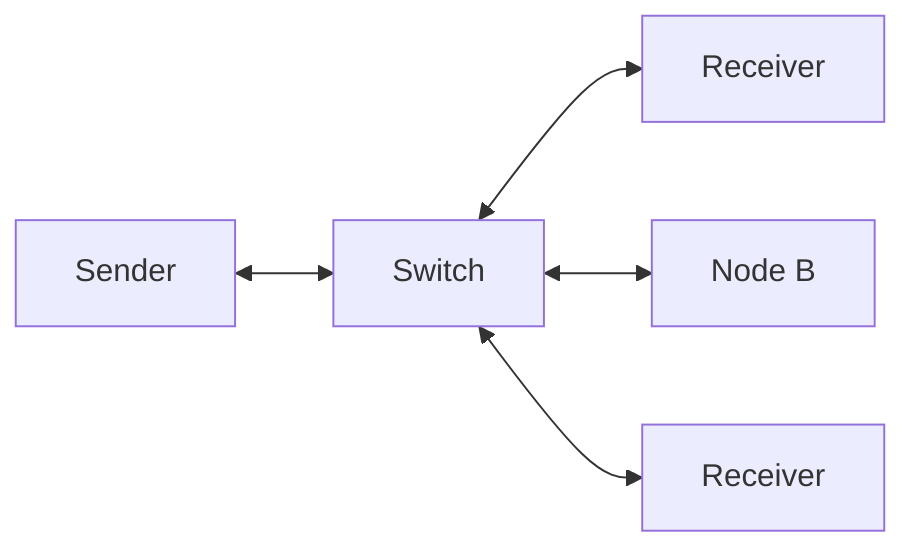
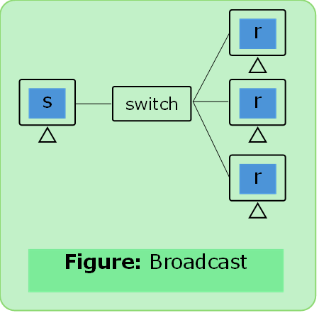
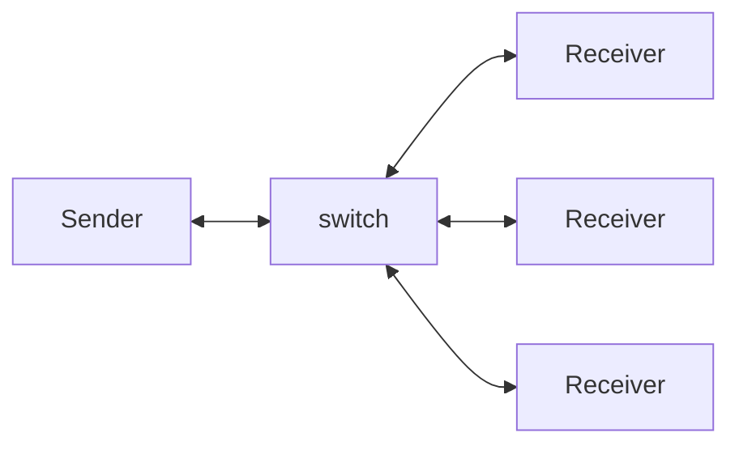

# Protocols

### Definition

- It is a set of rules that govern data communication.

### Elements of Protocol

#### 1. Message Encoding

#### 2.	Message Formatting and Encapsulation

- Agreed Format
- Encapsulate the information to identify the sender & receiver rightly.

#### 3.	Message Size

- Long messages must also be broken into smaller pieces to travel across a network.

#### 4. Message Timing

- Flow control
- Response Time out

#### 5.	Message Delivery Options

##### Unicast

- Unicast: one to one (1-1)

##### Multicast
- Multicast: One to many but not all.

    

##### Broadcast

- Broadcast: One to all.

    
    
