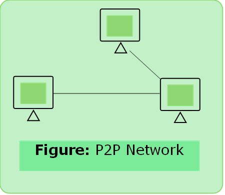
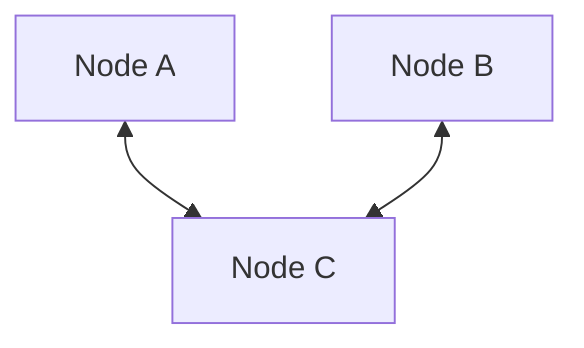
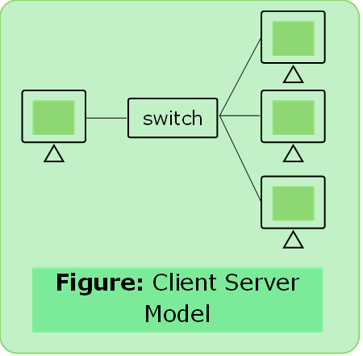
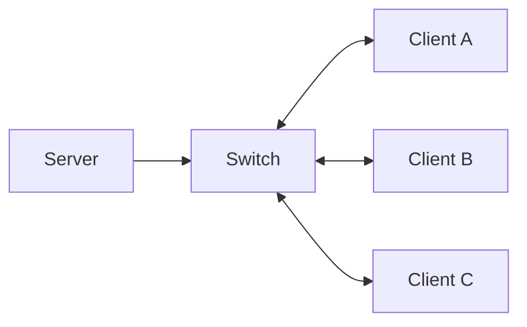

# Network Models

### Peer to Peer Network

- No centralized administration
- All peers are equal
- Simple sharing
- Not scalable

### Client Server Model

- Centralized administration
- Request-Response Model
- Scalable
- Server may be overloaded.
   

