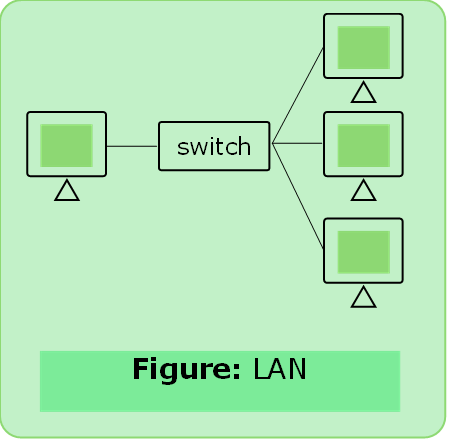
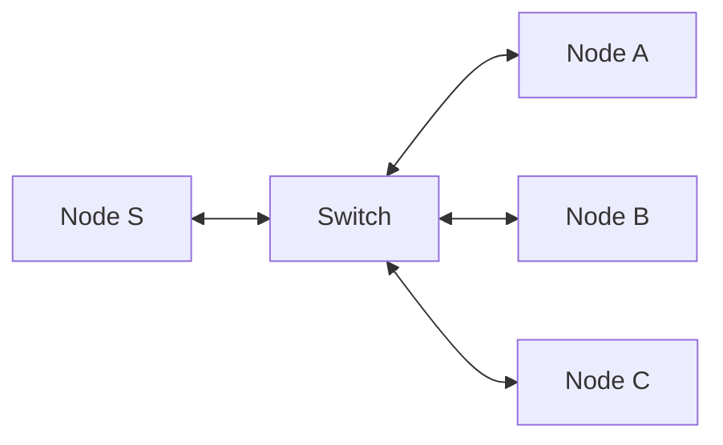
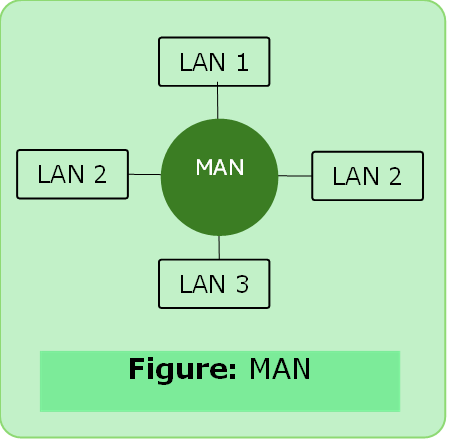
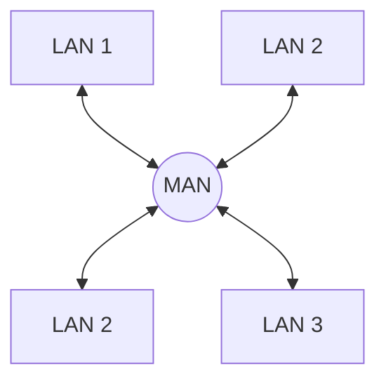
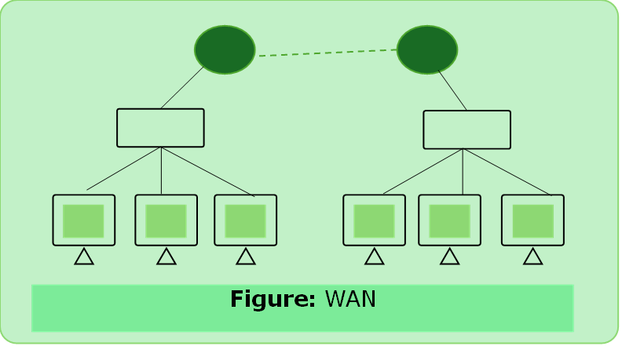
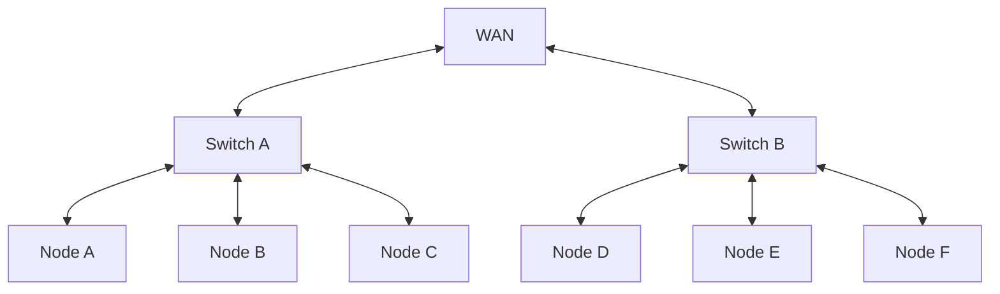

# Classification of CN

### 1.	LAN

- A local area network is a computer network that interacts computers within a limited area such as a residence, school etc.

#### LAN Devices

-  Wired LAN
	- Hub 
	- Switches

 - Wireless LAN
	 - Wi-Fi 

---

### 2. MAN

- A metropolitan area network is a computer network that interconnects users with computer resources in a geographic region of the size of metropolitan area(city).

#### MAN Devices

- Hub , Switches
- Routers, Bridges

---

### 3. WAN

- A wide area network is a telecommunications network that extends over a large geographical area for the primary purpose of computer networking.

#### WAN Devices
- End Devices
- Intermediary Devices

