# Network Topology

### Definition

- Arrangement of nodes of a computer network.
- Topology means layout

### Physical Topology
-  Placement of various nodes

### Logical Topology  
- Deals with data flow in the network

##### 1. Bus Topology

- Common transmission medium 
- Data will be received by all nodes in the network simultaneously.
- A signal containing the address of the intended receiving machine travel from a source in both direction to all nodes connected to the bus until it finds the intended recipient.

###### Advantages

1.	Less expensive
2.	Suited for temporary network
3.	Node failure does not affect others.

###### Disadvantages

1.	Not Fault tolerant
2.	Limited Cable Length
3.	No Security

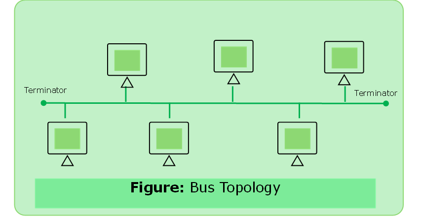

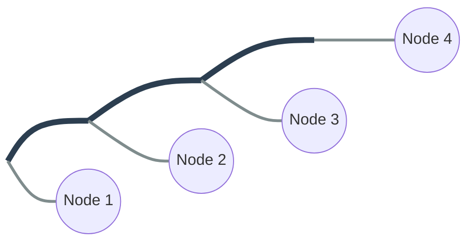

---

##### 2.	Ring Topology

- A ring topology is a bus topology in a closed loop.
- Peer to Peer Lan technology
- Two Connections: one to each of its nearest neighbors
- Unidirectional
- Sending and receiving data takes place with the help of a token.

###### Advantages

1.	Performance better than bus
2.	All nodes with equal access

###### Disdvantages

1.	Unidirectional
2.	Single point of failure will affect the network
3.	No Security
4.	Increment in load will cause poor performance.

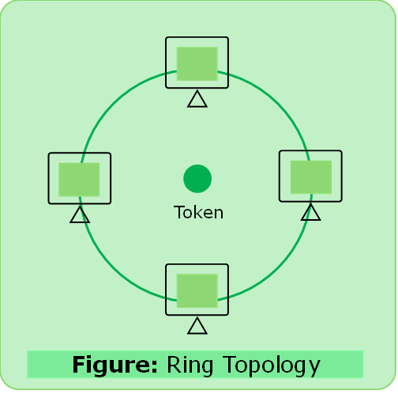

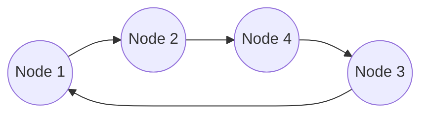

###### Dual Ring Topology

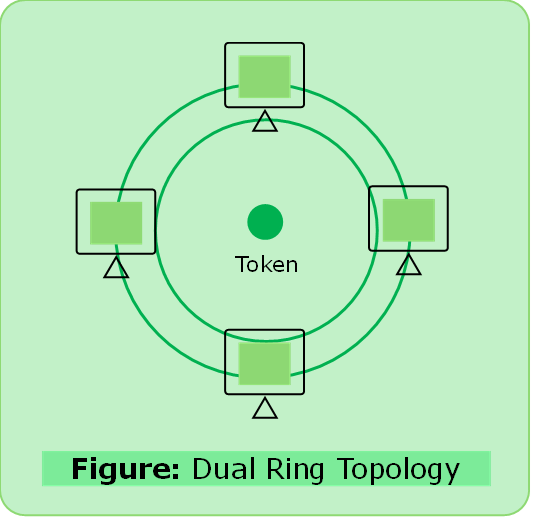

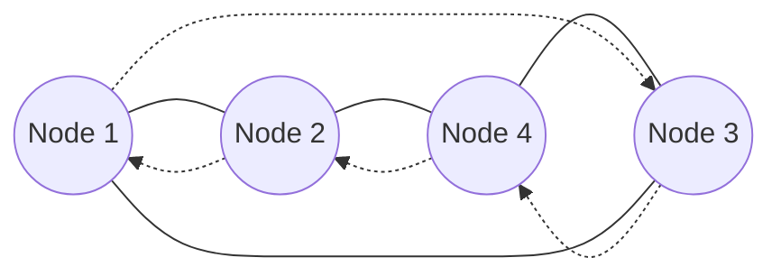

---

####  3.	Star Topology 

- Every node is connected to a central hub or switch.
- Centralized Management
- All traffic must pass through the hub/switch.

##### Advantages

1.	Easy to design & implement
2.	Centralized administration
3.	Scalable

##### Disadvantages

1.	Bottleneck due to overload switch/hub.
2.	Single point of failure will affect the network
3.	Increase cost due to switch/hub.

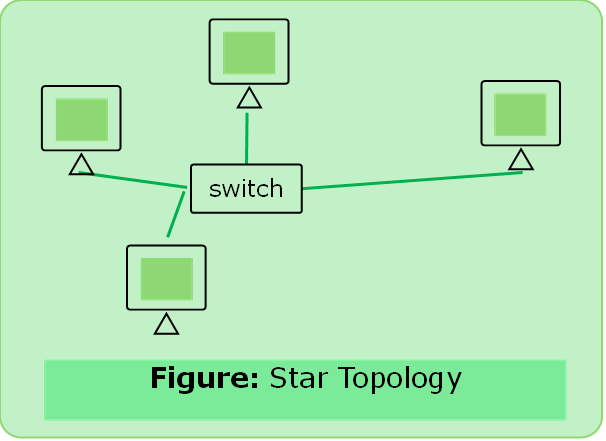

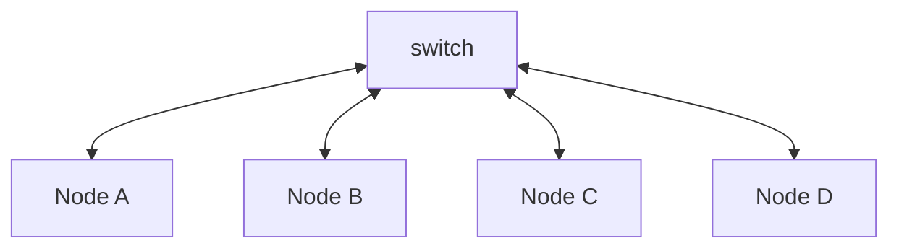

##### Extended Star Topology

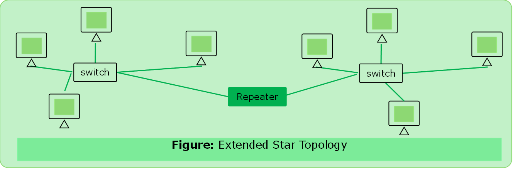

---

#### 4.	Mesh Topology

- Each node is directly connected to every other nodes in the network.
- Fault Tolerant and Scalable

##### Advantages

1.	Fault Tolerant
2.	Reliable

##### Disadvantages

1.	Issues with broadcasting messages
2.	Expensive and impractical for large networks.

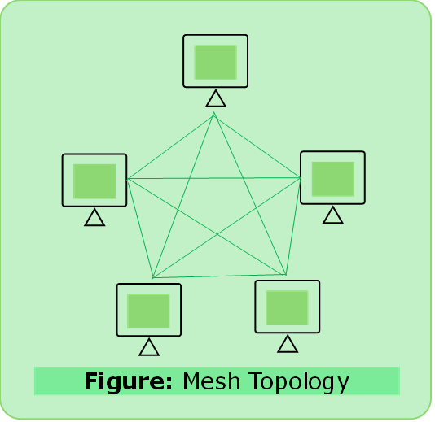

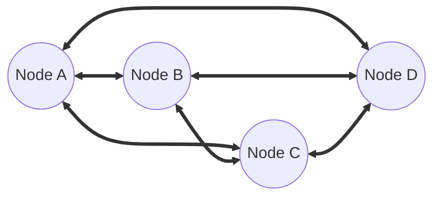

---

#### 5.	Hybrid Topology

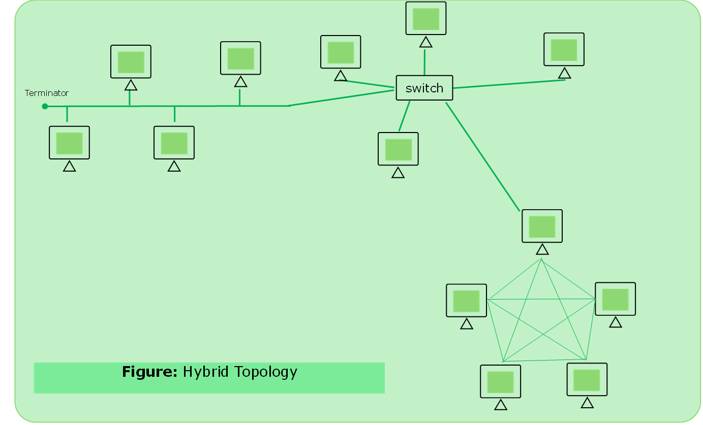

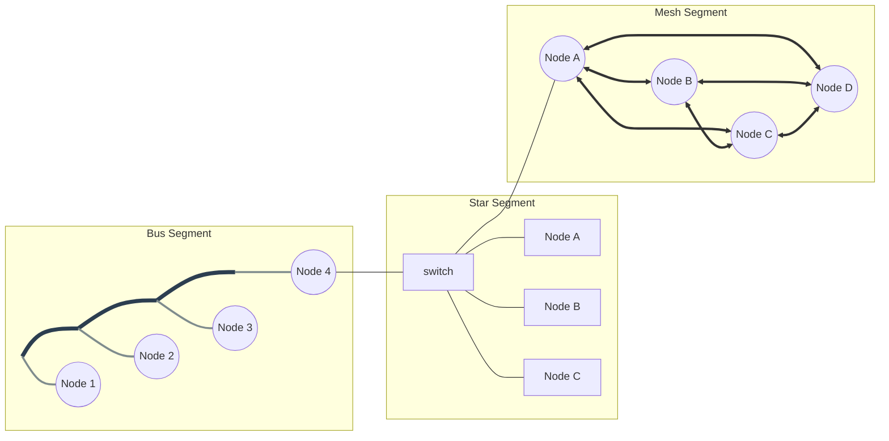
---

### Total Ports and Number of Cables

1. Star: Number of cables = n, Total ports = 2*n
2. Ring: Number of cables = n, Total ports = 2*n
3. Mesh: cables = n(n-1)/2, Total ports = n(n-1)

  
