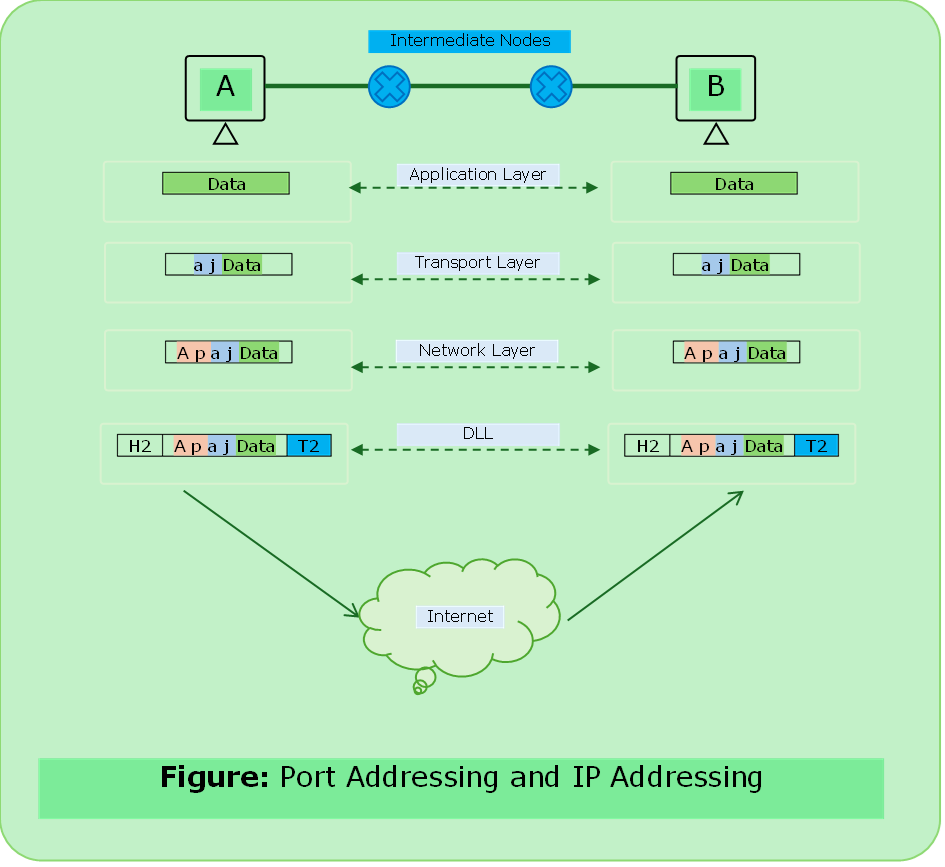

# Network Addressing

### 1. IP Addresses

- IP stands for Internet Protocol
- Every node in the computer network is identified with the help of IP address.
- Logical addresses
- Can change based on the locations.
- Assigned by manually or dynamically
- Represented in decimal and it has 4 octets.
- `0.0.0.0` to `255.255.255.255`

---

### 2. MAC Addresses

- Media Access Control
- Every node in the LAN is identified with the help of MAC addresses.
- Physical Address
- Unique
- Can not be changed
- Assigned by manufacturer
- Represented in hexadecimal
- 48 bits six octets
- Separator (`.` ,` –` , `:`)
- **MAC Address changes during the packet is in the transit. As sender does not know about the MAC of receiver so it put address of nearest router MAC.** 

---

#### IP vs MAC

| S.N. |                    IPv4                    |                     MAC                     |
| :--- | :---------------------------------------- | :----------------------------------------- |
| 1    |                  32 bits                  |                   48 bits                   |
| 2    |           Represented in Decimal           |                 Hexadecimal                 |
| 3    | Router needs IP addresses to forward data. | Switch needs MAC addresses to forward data. |

---

### 3.	Port Addresses

- In a node many processes will be running.
- Data must reach to the right process.
- Every process in a node is uniquely identified using port numbers.
- Ports are communication endpoint.
- Fixed numbers & Dynamic Port Numbers
- OS assigns dynamically. (`0` to `2^15`).

---

---

### IP vs MAC vs Port Address

- IP: Reaching our Network
- MAC: Reaching the host
- Port: Reaching to Process

    

