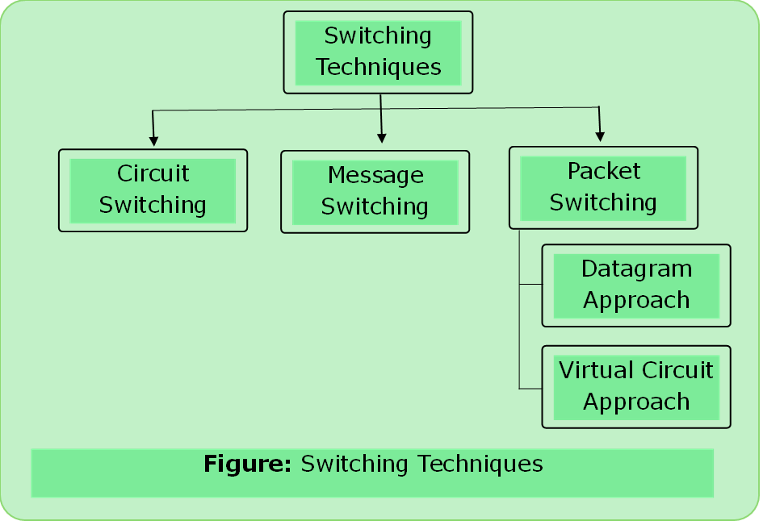
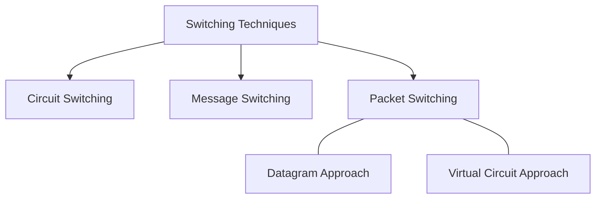

# Switching Techniques

- Switching in computer network helps in deciding the best route for data transmission if there are multiple paths in a larger network.
- One-to-One connection.

---

### 1.	Circuit Switching

- A dedicated path is established between the sender and receiver.
- Before data transfer, connection will be established first.
- Example- telephone network.
- ISDN (Integrated Services Digital Networks) protocol for establishing and breaking circuit switching.

- Three Phases
    1. Connection Establishment
    2. Data Transfer
    3. Connection Disconnection

---

### 2.	Message Switching

- Store and Forward Mechanism
- Message is transferred as a complete unit and forwarded using store and forward mechanism at the intermediary node.
- Not suited for streaming media and real-time applications.

---

### 3.	Packet Switching

- The internet is a packet switched network.
- Message is broken into individual chunks called as packets.
- Each packet is sent individually.
- Each packet will have `source_ip` and `destination_ip` With sequence number.

- Sequence number help:
    - Reorder the packets
    - Detect Missing packets
    - Send Acknowledgements

####  Datagram Approach

- Datagram packet switching is also known as connectionless switching.
- Each independent entity is called as datagram.
- Datagrams contain `destination_info` and the intermediary devices use this information to forward datagrams to right destination.
- In this approach, path is not fixed.
- Intermediary nodes take the routing information decisions to forward the packets.

#### Virtual Circuit Approach

- Virtual circuit is known as connection-oriented switching.
- In the case of virtual circuit switching, a preplanned route is established before the messages are sent.
- `Call req.` and `Call accept` packets are used to establish the connection between sender and receiver.
- In this approach, the path is fixed for the duration of a logical connection.

