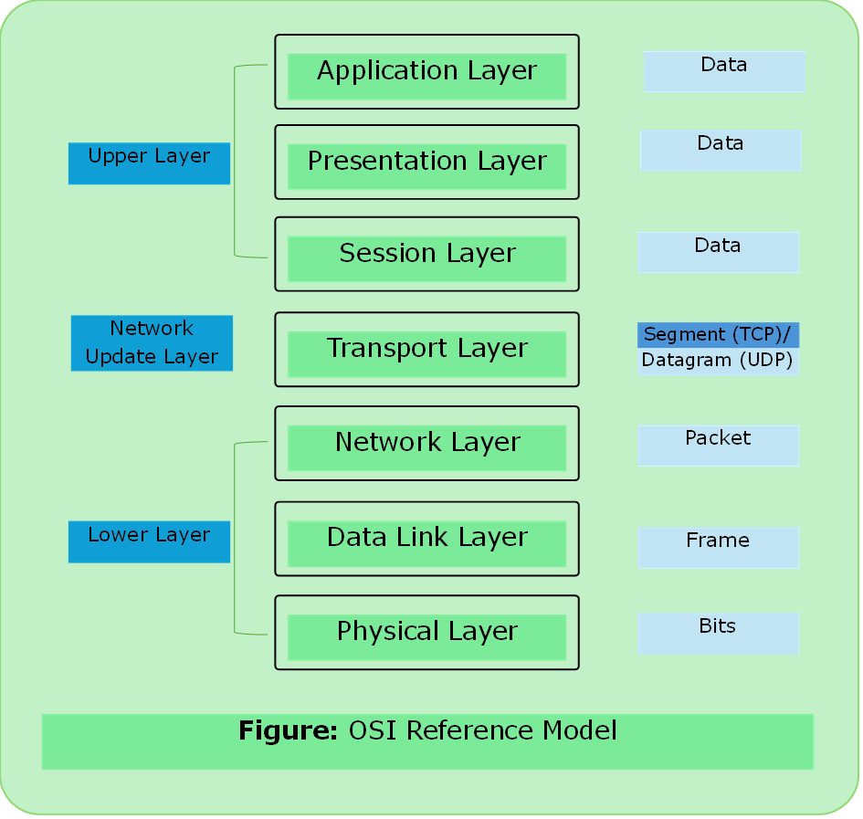
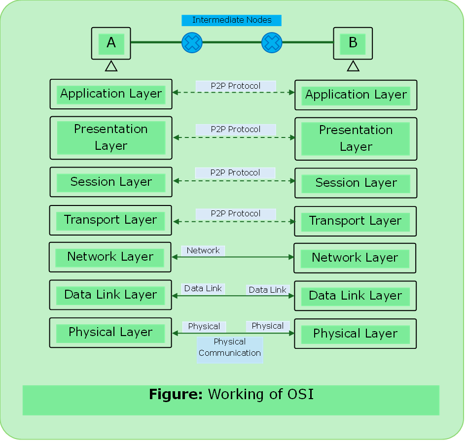
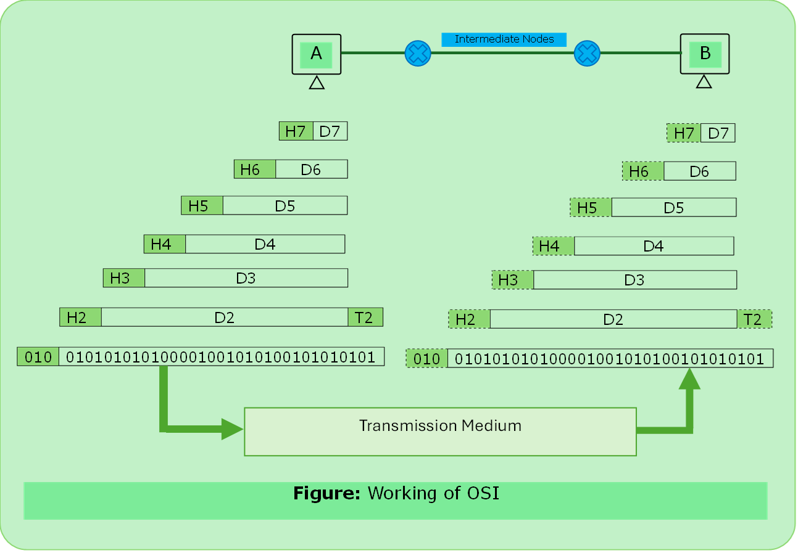

# OSI Model

- Open Systems Interconnection
- A model for understanding and designing a network architecture that is flexible, robust and interoperable.
- Developed by ISO(International Standard Organization).
- It’s not a protocol, it is only a guideline and hence it is referred as OSI reference model. It is never fully implemented.

---

---

### Purpose: 

- Showing how to facilitate communication between different systems without requiring changes to the logic of underlying hardware and software. 

### Working of OSI Model

---

#### Upper Layer
- It deals with the issues related to the application. It is implemented only in the software.
-  Both end user and application layer interact with the software application.

#### Lower Layer
- It manages data transport issues.
- Data Link Layer and Physical layer are implemented in hardware and software.

---

### 1.	Application Layer

- It enables the use to access the network resources.

- Services
    1. File Transfer & Access Management (FTAM)
    2. Mail Services
    3. Directory Services

### 2.	Presentation Layer

- It is concerned with the syntax & semantics of the information exchanged between two systems.

- Services
    1. Translation
    2. Encryption
    3. Compression

### 3. Session Layer

- It establishes, maintains and synchronizes the information among communicating devices.

- Services

    1. Dialog Control
    2. Synchronization

### 4.	Transport Layer

- It is responsible for process-to-process delivery of the entire message.

- Services

    1. Port Addressing
    2. Segmentation & Reassembly
    3. Connection Control
    4. End-End Flow Control
    5. Error Control

### 5.	Network Layer

- It is responsible for delivery of data from the original source to destination network.

- Services

    1. Logical Addressing
    2. Routing

### 6.	[Data Link Layer](../computer_network/15_data_link_layer.md)

- It is responsible for moving frames from one node to another node.

- Services
    1. [Framing](../computer_network/framing.md)
    2. [Physical Addressing](../computer_network/physical_addressing.md)
    3. [Flow Control](../computer_network/flow_control.md)
    4. [Error Control](../computer_network/error_control.md)
    5. [Access Control](../computer_network/multiple_access_protocols.md)

### 7.	[Physical Layer](../computer_network/14_physical_layer.md)

- It is responsible for transmitting bits over a medium. It also provides electrical & mechanical specifications.

- Services

    1. [Physical Characteristics of the media](../computer_network/14_physical_layer.md)
    2. Representation of bits
    3. Data Rate
    4. Synchronization of bits
    5. [Line Configuration](../computer_network/14_physical_layer.md#line-configuration)
    6. [Physical Topology](../computer_network/07_network_topology.md)
    7. [Transmission Mode](../computer_network/01_data_communication.md#data-flow)

