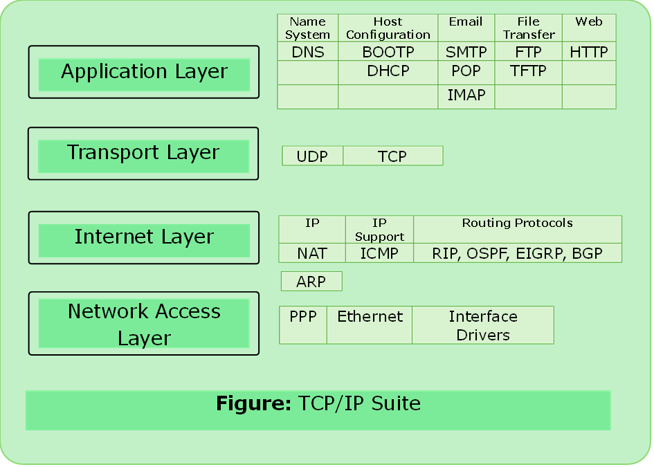

# TCP/IP Model

- The TCP/IP suite was developed prior to the OSI.
- Therefore, the layers in the TCP/IP protocol suite do not exactly match those in the OSI model.
- TCP/IP is a hierarchical protocol made up of interactive modules each of which provides a specific functionality.

---

---

### 1.	Application Layer

- Represents data to the user, encoding & dialog control
- PDU:- Data

### 2.	Transport Layer

- Supports communication between diverse devices across diverse networks.
- PDU:- Segment (TCP) or Datagram (UDP)

### 3.	Internet Layer

- Determines the best path through the network.
- PDU:- Frame (Medium Dependent)

### 4.	Network Access Layer

- Controls the hardware devices and media that make up the network.
- PDU:- Bits

---

### Protocol Data Unit (PDU)

- Protocol Data Units are named according to the protocols of the TCP/IP suite: data, segment or datagram, packet, frame, bits. 

---

## Difference between OSI and TCP/IP 

| S.N. | Parameter             | OSI                                                       | TCP/IP                                                  |
| -------- | ------------------------- | ------------------------------------------------------------- | ----------------------------------------------------------- |
| 1.       | Definition                | General purpose, protocol-independent networking framework    | Specialized network protocol                                |
| 2.       | Nature of Development     | Theoretical Reference Model                                   | Implemented protocol suite                                  |
| 3.       | Approach                  | Vertical Approach- each layer is clearly defined              | Horizontal Approach- overlap of work in layers is possible. |
| 4.       | Nature of Transport Layer | Only connection oriented                                      | Both TCP and UDP                                            |
| 5.       | Nature of Network Layer   | Both types of service(connection oriented and connection les) | Only connectionless such as IP                              |
