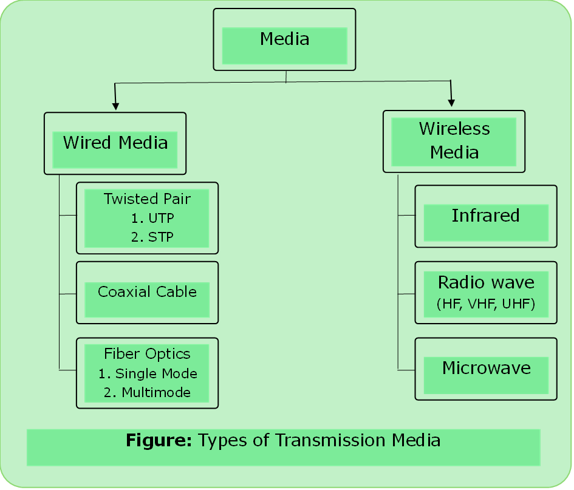

# Physical Layer

- Major function of the physical layer is to move data in the form of electromagnetic signals across a transmission.

### Signal

- It is a function that represents the variation of a physical quantity with respect to time.

#### 1. Analog Signal
- It can take any value in the defined range.
- All real-life signals are analog in nature.

#### 2.	Digital Signal
- It can take only finite values at any given time.
- Discretization of both time and magnitude.

---

### Transmission Media

#### Wired Media

- Signal flows through physical path.

1. [Twisted Pair](../computer_network/twisted_pair.md)
2. [Co- axial Cable](../computer_network/co-axial.md)
3. [Fiber Optics](../computer_network/fiber_optics.md)

#### Wireless Media
- Information is exchanged via air or vacuum. There area following concerns Coverage Area, Interference and Security.

1. [Radio Waves](../computer_network/radio_wave.md)
2. [Micro Waves](../computer_network/micro_wave.md)
3. Infrared
 - Frequency: 300 - 400 GHz
 - Short range communication
 - Home appliances

##### Technologies

| 1.      Wi-Fi    | IEEE 802.11 | Up to 7 Gbps          |
| ---------------- | ----------- | --------------------- |
| 2.     Bluetooth | IEEE 802.15 | Range is up 10 meters |
| 3.     Wi- Max   | IEEE 802.16 | Up to 1 Gbps          |

---

### Line Configuration

1. Point to Point
- Dedicated link between two devices
- The entire capacity of the link is reserved for transmission between these two devices.

2. Multipoint Connection
- Two or more devices share a single link.
- Capacity of link is shared. (spatial and turnwise)

