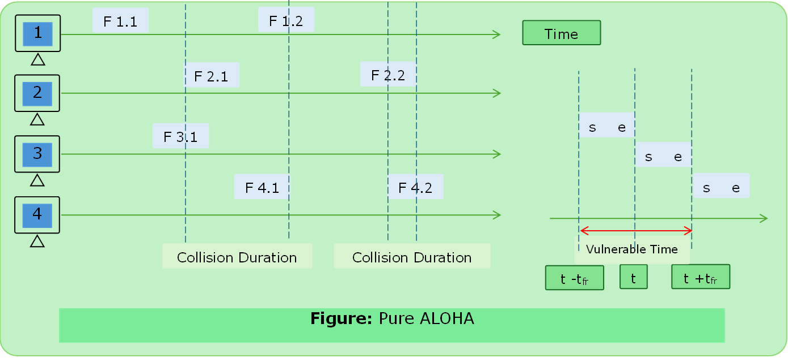
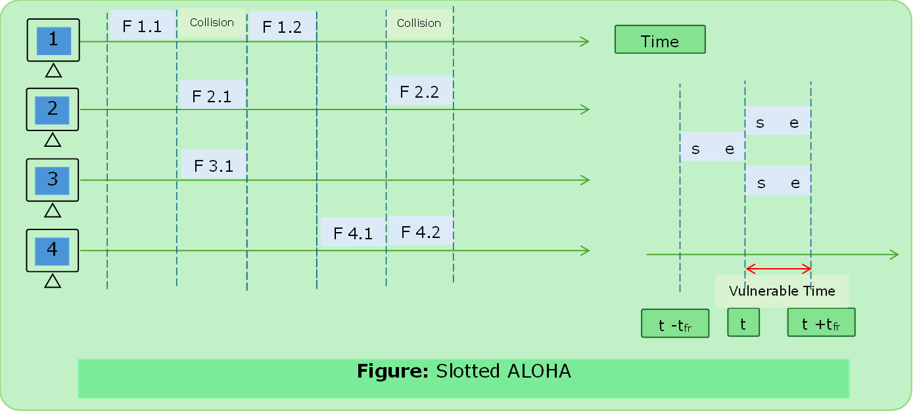

# ALOHA

- Random access protocol designed for WLAN but can be used for shared medium.
- Multiple stations can send at the same time & can hence lead to collision.

### Types of ALOHA

#### Pure ALOHA
- Pure ALOHA allows stations to transmit whenever they have data to send.
- Since different stations wait for diff. amount of the time the probability of further collision decreases.
- Maximum throughput is when uniform length frame.
- Even if a single bit is overlapped both frames will be corrupted.

```text

Start
K = 0 #Number of attempts
Send Data and wait for ack (2*TP);
if (ack not received):
    K = K + 1 #KMAX is normally set to 15.
    
    if(K>KMAX):
        Stop;
    else:
        #Choose R between (0, 2K-1) back-off Time TB = R*TP.
        #TP = Propagation Time
        wait for back-off (random amount) time and go to step 2.

else: 
    SUCESS
    Stop

```
##### Formula

>$\text{If G is the number of nodes wish to transmit in the same time.}$

$$
\begin{aligned}
\text{Vulnerable Time } &= 2\times\text{T}_\text{fr} \\
\text{Throughput } &= \text{ G}\times e^{-2\times\text{G}} \\
\text{Throughtput}_\text{max} &= 0.184 \text{ for G } = 0.5 \\

\end{aligned}
$$




---

#### Slotted ALOHA

- Developed to improve the efficiency of pure ALOHA.
- The time of the shared medium is divided into discrete time intervals called slots.
- **Sending of data is allowed only at the beginning of these slots.**
- If a station misses out the allowed time it must wait for the next slot. This reduces the probability of collision.
- >$\text{If G is the number of nodes wish to transmit in the same time.}$

##### Formula

$$
\begin{aligned}
\text{Vulnerable Time} &= \text{T}_\text{fr} \\
\text{Throughput} &= \text{G} \times e^{-\text{G}} \\
\text{Throughput}_{\text{max}} &= 0.368 \text{for G} = 1
\end{aligned}
$$




---

##### Pure ALOHA vs Slotted ALOHAR

| S.N. | Pure ALOHA                                          | Slotted ALOHA                                                        |
| ---- | --------------------------------------------------- | -------------------------------------------------------------------- |
| 1.   | Any station can transmit the data at any time.      | Any station can transmit the data at the beginning of any time slot. |
| 2.   | Time is continuous and not globally synchronized.   | Time is discrete and globally synchronized.                          |
| 3.   | Vulnerable Time:   $2\times\text{T}_\text{fr}$      | Vulnerable Time:     $\text{T}_\text{fr}$                            |
| 4.   | Throughput:  $\text{ G}\times e^{-2\times\text{G}}$ | Throughput:  $\text{ G}\times e^{-\text{G}}$                         |
| 5.   | Maximum Efficiency: $18.4\% \text{ at G} = 0$.5     | Maximum Efficiency: $\text{36.8}\%\text{ at G } = 1$                 |


---

