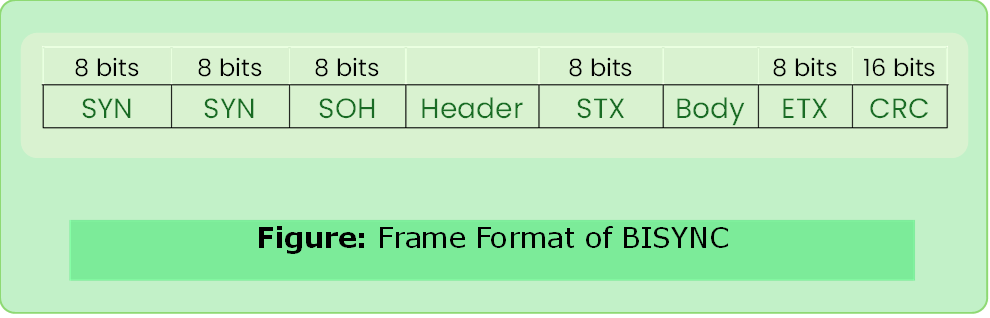

# BISYNC

- Binary Synchronous Communication Protocol
- It is sentinel approach developed by IBM.

### Header Format

- Frames transmitted beginning with leftmost field.
- DLE: Data Link Escape (used in [byte stuffing](#byte-stuffing))

---

### Byte Stuffing

- Byte/char stuffing is the process of adding one extra byte whenever there is a flag or escape character in the text.

