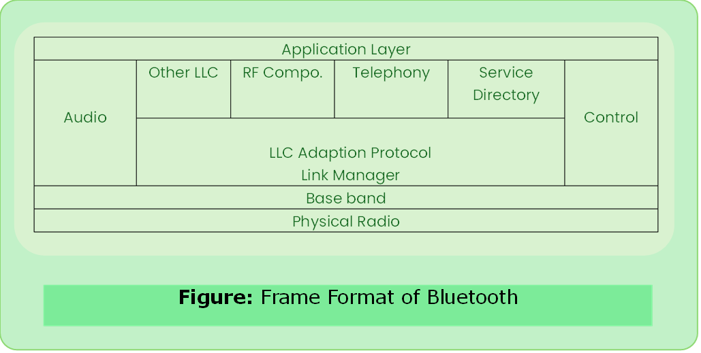

# Bluetooth

- Wireless technology standard used for short distance communication UHF in ISM (Industrial Scientific & Medical).
- Named after Herald Bluetooth
- It is specified by BSIG (Bluetooth Special Interest Group).
- It specifies entire suite of protocols going beyond the link layer to define application protocols (profiles).

### Piconet

- Communication between master and slaves only.
- Slave cannot communicate with each other.
- Slave can be parked: set to an inactive, low-power state.

### Scatternet
- Group of piconet

### Advantages of Bluetooth

- penetrate through walls
- ad-hoc communication

### Limitations of Bluetooth
- small range 10m

### Blues naffing
- Unauthorized access of information through a Bluetooth connection. Theft of information.

---
### Bluetooth Protocol Stack

#### Physical Radio (RF) Layer
- Performs modulation/demodulation
- Physical characteristics of Bluetooth transceiver
- Two types of physical link -> connection less and connection oriented.

#### Baseband Link Layer:- 

- Connection establishment within in a piconet.

#### Link Manager
- management of already established links
- Authentication & encryption processes.

#### LLC Adaption Protocol:-
- heart of Bluetooth protocol stack
- packages data from upper layer int to form expected by lower layers.
- Segmentation & multiplexing

#### RF Comm. Layer:-
- Radio Frontend Component. It provides serial interface for WAP (wireless application protocol) and OBEX (object exchange).

#### SDP Layer
- Service Directory Protocol allows to discover the services available on another Bluetooth enabled device.

