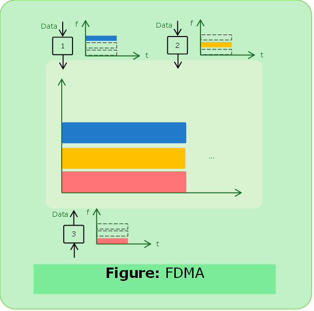
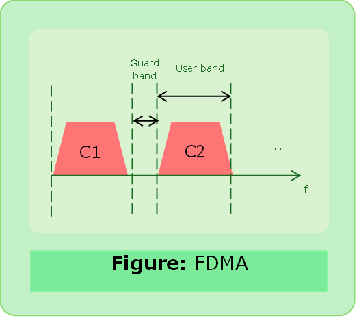
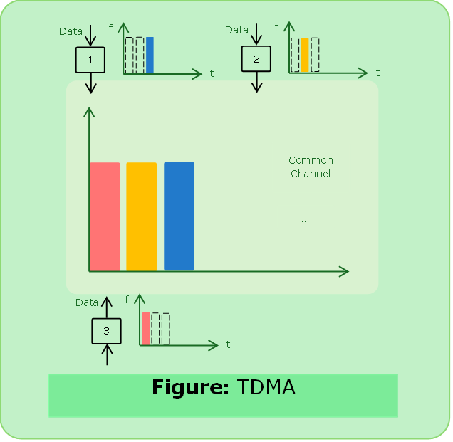
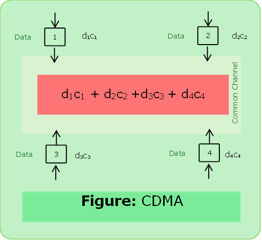

# Channelization Protocol

- The available bandwidth of a link is shared in time, frequency or through code between different stations.

### Types of Channelization Protocol

#### FDMA
- Frequency Division Multiple Access 
- The available bandwidth of common channel is divided into bands that are separated by guard bands.
- Available bandwidth is shared by all stations.
- FDMA is a `dll` protocol that uses Frequency Division [Multiplexing](../computer_network/multiplexing.md) physical layer.

---

#### TDMA

- Time Division Multiple Access
- The bandwidth is just one channel that is time shared between different stations.
- Stations share the capacity of the channel in time.

---

#### CDMA

- Code Division Multiple Access
- One channel carries all information simultaneously.
- CDMA differs from FDMA because only one channel occupies the entire bandwidth of the link.
- CDMA differs from TDMA because all stations can send data simultaneously, there is no time sharing.

##### Code Properties

- If we multiply each code by another we get = 0.
- If we multiply each code by itself we get = no of nodes.

