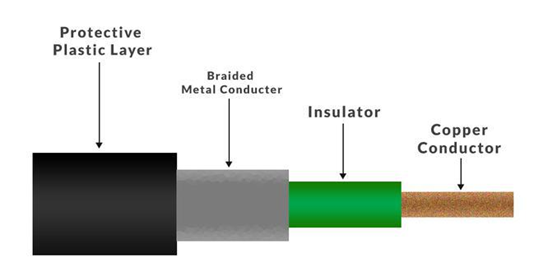

# Co- axial Cable

- Commonly used in cable TV networks, broadband internet and CCTV (closed circuit television) camera network.
- Signal: Electromagnetic Signal
- Connectors: **BNC (Bayonet Neill Concelman)**
- Speed: 1 to 2 Gbps for 1 Km cable.
- Better security compared to twisted pairs.

