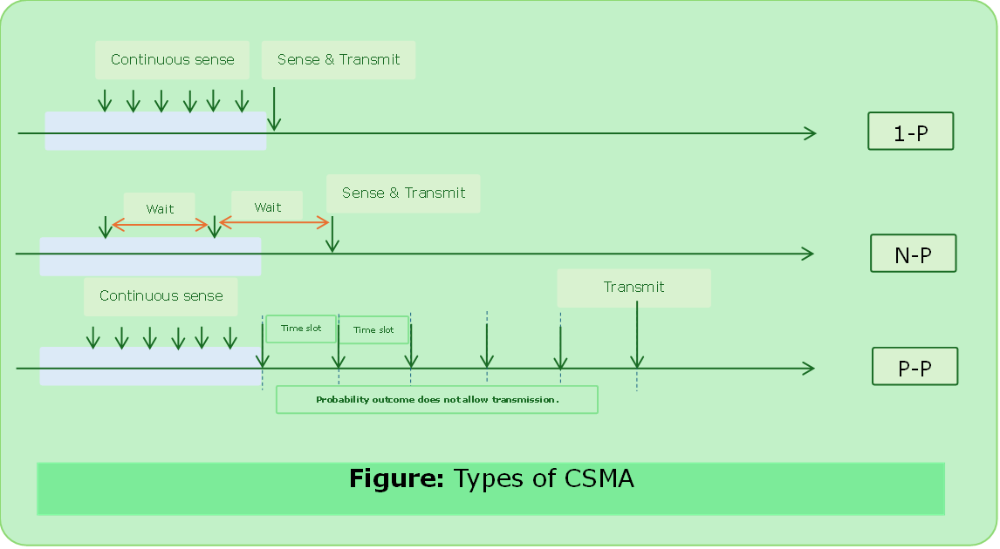
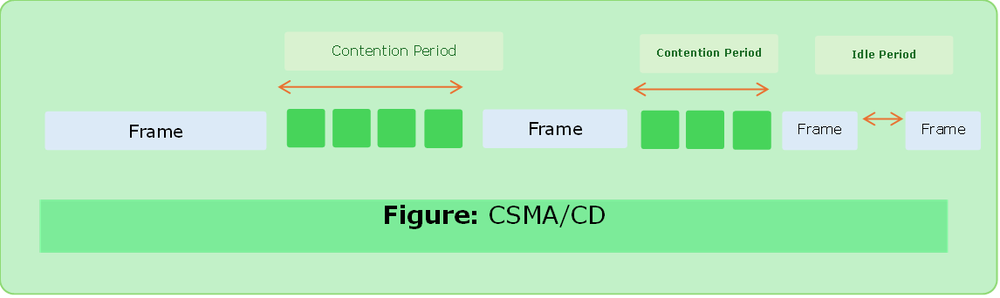

# CSMA

- Carrier Sense Multiple Access
- To minimize the chance of collision & therefore increase in performance.
- “Sense before send” or “listen before talk”.
- The probability of collision exists because of propagation delay. (a station may sense the carrier as idle but first bit transmitted by another node has not yet been received.)

### Types of CSMA

#### 1-Persistent CSMA
- If channel is idle, the station transmits a frame.
- If busy, it sense continuously & transmits (with probability 1) immediately as it finds the channel idle.
- The longer propagation delay the more important this effects become and worse the performance.

#### Non-Persistent CSMA
- Before sending it senses the channel if it is idle then it transmits.
- If channel is busy, it does not continuously check it check after a random period of time.
- Better channel utilization but longer delays than 1-Persistent.
 

#### P-Persistent CSMA
- *Applies to Slotted Aloha.*
- It senses the channel if it is idle, it transmits with a probability of $\text{P}$.
- With probability $\text{q } = 1- \text{ p}$ it differs until next slot.
- This process is repeated either frame is transmitted or another station starts transmission.
- In that case it acts like as if there had been a collision. (waits for random time and starts again).
- If station initially finds channel it waits for next slot and applies the above algo.

#### O-Persistent CSMA
- Every node is assigned a transmission order by a supervisory node.

---

### CSMA/CD

- Collision Detection
- If two stations sense the channel to be idle and begin transmission simultaneously, they will both detect the collision almost immediately.
- Collision can be detected at the power or pulse width of the received signal comparing it to the transmitted signal.
- They should stop transmitting as soon as possible the collision is detected and waits for random period of time.
- It saves time & bandwidth.
- Used in LAN ethernet in the MAC sublayer.
- This model consists **alternate contention & idle period**.

##### Formula

$$
\begin{aligned}
\text{Efficiency } &= \left( \frac{1}{1 + 6.44 \times \text{a}} \right) \\
\text{a } &= \frac{\text{T}_\text{p}}{\text{T}_\text{t}}
\end{aligned}
$$

1. High Distance -> Low Efficiency
2. Longer packet length -> high efficiency (`Limit: 1500 Bytes`)
3. $\text{T}_\text{t} \ge \text{ RTT of }1 \text{ bit}$

---

### CSMA/CA

- Collision Avoidance
- Carrier sensing is used but nodes attempt to avoid collision by beginning transmission only after the channel is sensed “idle”.
- Important for wireless networks, where [CSMA/CD](#csmacd) is not possible due to wireless transmitters desensing their receivers during packet transmission.
- CSMA/CA is unreliable due to [hidden node problem](../computer_network/wi-fi.md#hidden-terminal-problem) & [exposed terminal problem](../computer_network/wi-fi.md#exposed-terminal-problem).
- Solution: [RTS](../computer_network/wi-fi.md#hidden-terminal-solution)/[CTS](../computer_network/wi-fi.md#exposed-terminal-solution) ([MACA algorithm](../computer_network/wi-fi.md#maca))
- Operates in DLL. Example:- [Wi-Fi (IEEE 802.11)](../computer_network/wi-fi.md#wi-fi)

