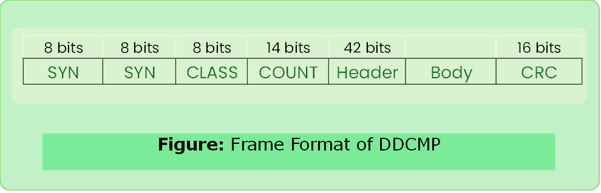

# DDCMP

- Designed by Digital Equipment Protocol.
- Byte-counting approach 
- Count: bytes are contained in the frame body

### Frame Format

#### Drawback of count
- If transmission error corrupted the count field then end of frame will not be detected correctly by the receiver.

