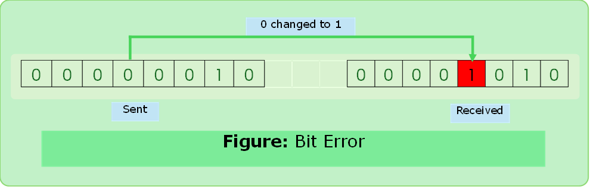
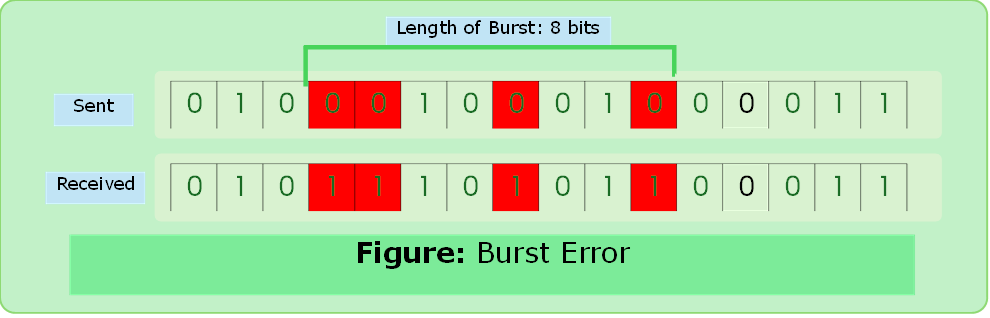
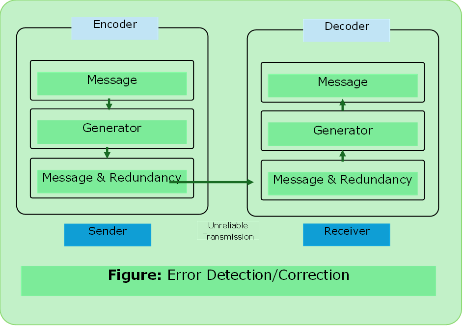
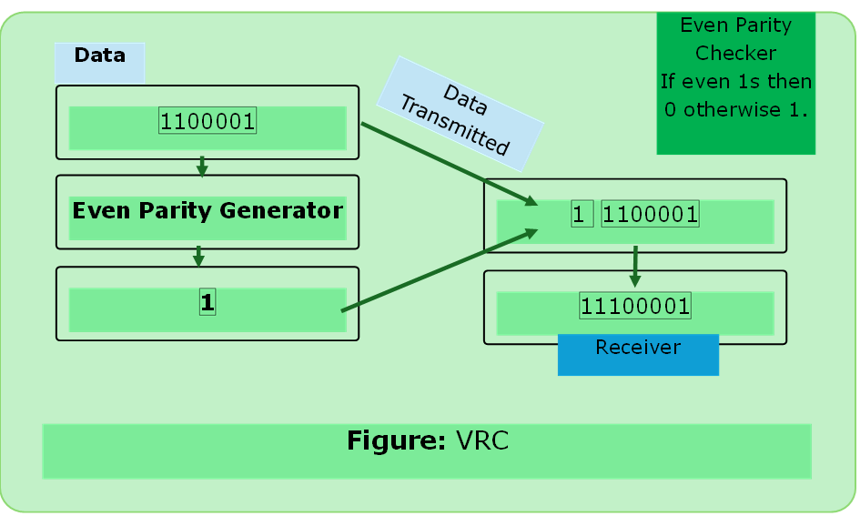
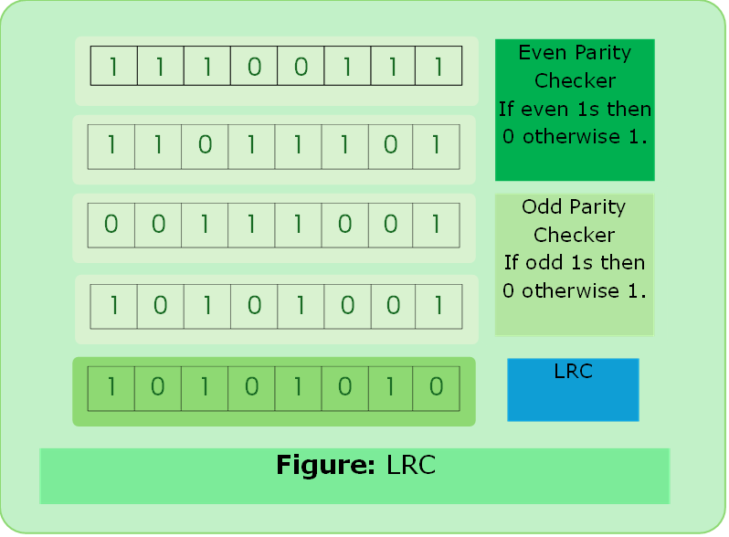

# Error Control
### Error
- Data can be corrupted during transmission. Errors must be detected and corrected.
- Error detection and correction is either implemented at either DLL or Transport Layer.

### Error Types
#### Bit Error
- In a single bit error, only 1 bit in the data unit has been changed.



#### Bit Error

- In burst error two or more bits in the data unit have changed.



---

### Error Detection:
- Error detection means to decide whether the received data is correct or not without having a copy of the original message.
- We have to send extra bits with data for error detection. These bits are called **Redundant Bits**.

### Error Correction:
- Receiver can ask for retransmission.
- Receiver can use an error-correcting code which automatically corrects certain errors.


---

### Error Detection Techniques:

#### VRC (Vertical Redundancy Check)
- Parity Check
- VRC 1 if odd number of 1’s (even parity generator)
- VRC 0 if even number of 1’s (even parity generator)

##### Performance
- Detect only single bit error.
- It can detect burst error only if number of errors is odd.




#### LRC (Longitudinal Redundancy Check)
- Block of bits are arranged in rows and columns.
- Two Dimensional Parity
- The parity is calculated for each column set along with the data.
- `Block of parity` as redundant data.

##### Performance
- Likelihood of burst error detection is increase.
- If two bits in exactly the same positions in two data units are damaged, then LRC checker will not work.
- Correction up to 1 bit.



#### Checksum
##### Sender side
```text
 1. Break message in `k` number of block of same length containing `n` bits.
 2. Sum all `k` data blocks if any carry comes add it.
 3. Take `1’s complement` = checksum
```

##### Receiver side
```text
1. Collect all data and calculate sum
2. If sum is all 1 then accept, otherwise reject.
```

##### Performance
- Detects all errors involving odd number of bits.
- Detects most errors involving even number of bits.
- **Fails** if sum of columns don’t change it will fail.

#### CRC (Cyclic Redundancy Check)
##### Sender side
```text
1. Find the length of the divisor `L`.
2. Append `L-1` bits to the original message. 
(`remainder <= divisor`)
3. Perform Binary Division
4. Remainder of Division = CRC
5. `XOR`: Same input => 0, otherwise 1
```
##### Receiver side
1. Data received by receiver % divisor must give remainder all 0s.

---

##### [CRC Solved Problem](../computer_network/solved_problems_cn.md#problem-1)


