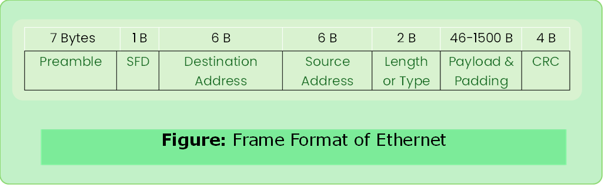
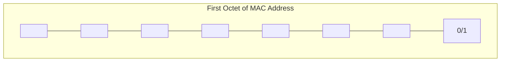

# Ethernet

- Most widely used wired LAN technologies.
- Operates in DLL & physical layer.
- IEEE 802.2 and IEEE 802.3
- Layer-2 protocol and layer-1 technologies.

---

### Frame Format

#### SFD
- Start Frame Delimiter
- `10101011`

#### Preamble
- 56 bits of alternating `0` & `1`

|   | Payload Length  | Frame Length  |
|---|---|---|
|**Min**|46 bytes|64 bytes|
|**Max**|1500 bytes|1518 bytes|

#### Ethernet Address

- MAC Address 48 bytes. Six octets of 8 bits.

- Unicast: `0` 
- Multicast: `1`
- Broadcast: all bits are `1` in first octet

---

### Ethernet Transmitter Algorithm

- Ethernet’s media access control is implemented in hardware NIC.
- Access Method: *CSMA/CD*, **1-Persistent**
- Encoding Method: Manchester Encoding (bits-> signals)
- No centralized control if collision happens then **32-bit jamming signal** & stops transmission.
- Transmitter will minimally send 96 bits (64 preamble + 32 bit jam).

#### Runt Frame

- A runt frame is ethernet frame that is less than IEEE 802.3’s minimum length 64 bytes.
- Runt frames are mostly caused by collisions.
- Other reasons: malfunctioning NIC, buffer underrun, duplex mismatch, software issues.
- Worst Case: `A` sends a packet at $t$. Packet arrives at $t+d$. `B` starts $t+d$. This leads to collision. `B`’s runt frame arrive at `A` at $t+2d$.

#### Exponential Backoff

- Once collision detected, transmission is stopped and sender waits for a certain period of time.
- Each time it finds channel busy it waits **the double amount of time** it waits before trying again.

---

### Pros of Ethernet

1. All nodes have same privilege (does not follow client-server architecture).
2. Robust to noise.
3. Quality is good and inexpensive and mostly used wired LAN technology. 

### Cons of Ethernet

1. Under heavy loads, network’s capacity is wasted.
2. Not good for real time applications.
3. Network cannot set priorities. (not suitable for client -server archit.)
4. Interactive applications dummy data have to fed to get frame size (46 B).
5. Receiver does not sent any ack. 

---

### Ethernet Cats

|     Name      |        Type         |    Speed    |
| :-----------: | :-----------------: | :---------: |
|     Cat 3     |     Unshielded      |   10 Mbps   |
|     Cat 5     |     Unshielded      | 10/100 Mbps |
|    Cat 5e     |     Unshielded      |  1000 Mbps  |
|     Cat 6     | Unshielded/Shielded |   1 Gbps    |
| Cat 6a, Cat 7 |      Shielded       |   10 Gbps   |
|     Cat 8     |      Shielded       |   40 Gbps   |

### [Solved Problems Ethernet](../computer_network/solved_problem_ethernet.md)