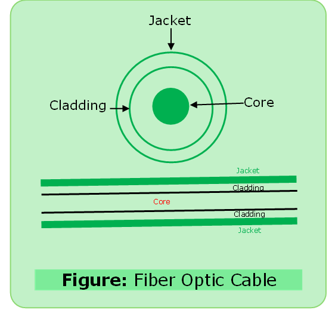
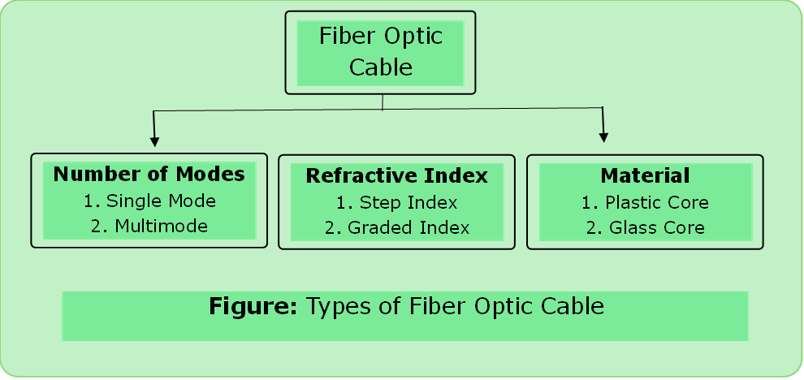

# Fiber Optics

- Light waves (no danger of electricity) 
- High Speed Transmission
- Total Internal Reflection
- No effect of EMI and RFI
- Highly secured

- If $n_1$ is refractive index of core and $n2$ refractive index of cladding then
$n_1>n_2$ then,
 - Numerical aperture is calculated by 
 $$N.A. = \sqrt{n_1^2 - n_2^2}$$
 - $\text{Angle of incident} (i) > \text{critical angle}$

---

### Types

- In step index refractive index of core is constant
- In graded index fiber it decreases as the distance from center of core increases.

