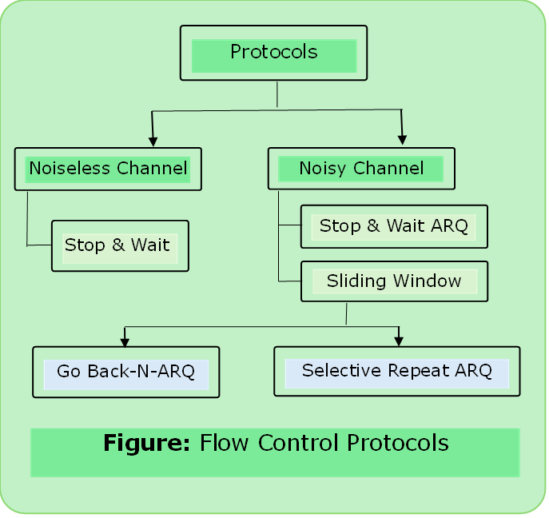
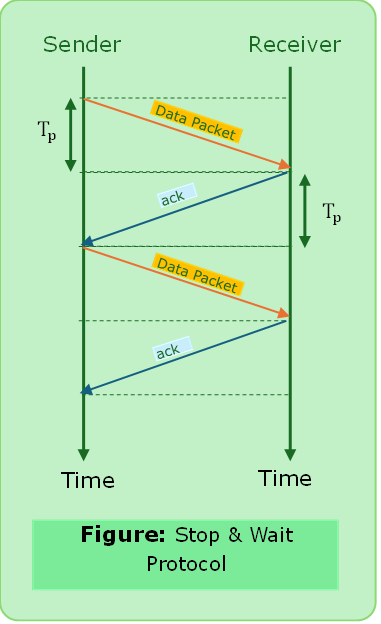
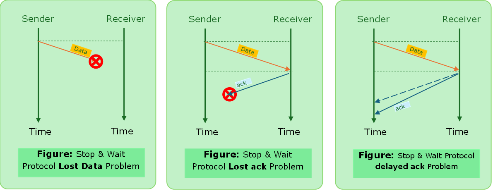
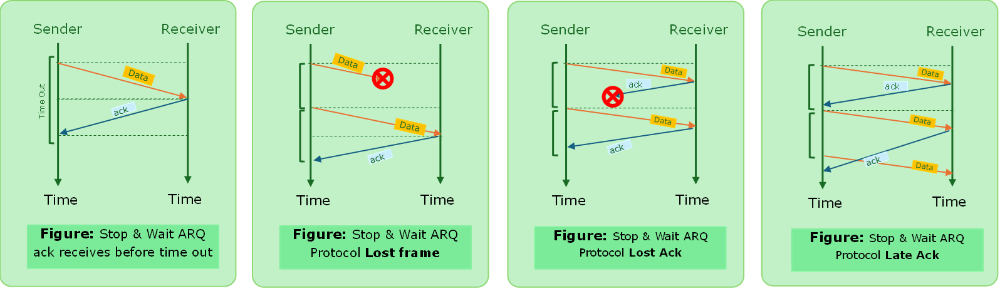
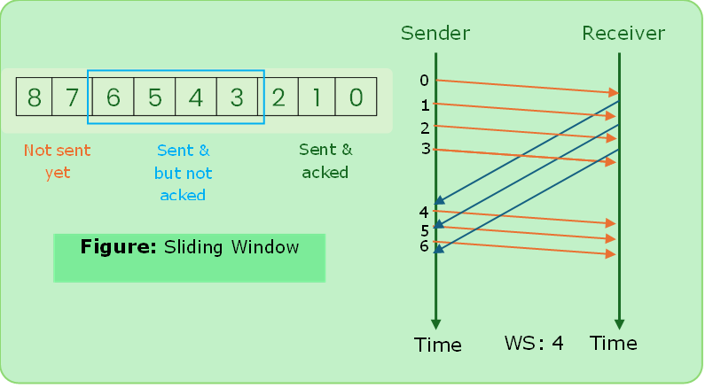
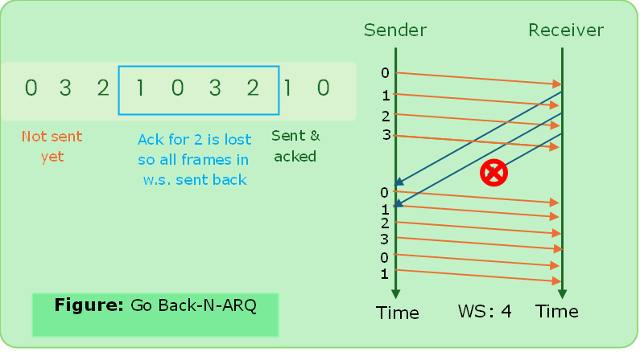
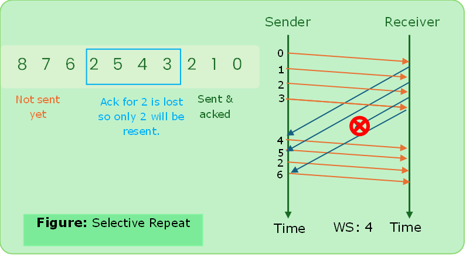

# Flow Control
- Speed matching mechanism
- This is one of the duties of data link control sublayer.
- Flow control in data link in node to node. (**hop by hop**)
- Flow control co-ordinates the amount of data that can be sent before receiving an acknowledgement.
- Receiver has a limited speed at which it can process incoming data and a limited amount of memory in which to store incoming data.
- Before these limits are reached, it must request that the transmitter to send fewer frames or stop temporarily.

---

### Stop & Wait Protocol

- It provides unidirectional data transmission with flow control facilities but without error control facilities.
- After transmitting one frame, the sender waits for an ack before transmitting the next frame.

#### Disadvantages

##### Lost Data

- Sender waits for ack for infinite amount of time.
- Receiver waits for data for an infinite amount of time.

##### Lost Ack
- Sender waits for ack for infinite amount of time.

##### Delayed Ack/Data
- After timeout on sender side, a delayed ack might be wrongly considered as ack of some other data packets.

---

### Stop & Wait ARQ
- ARQ = Automatic Repeat Request Protocol
- After transmitting one frame, the sender waits for an ack before transmitting the next frame.
- If the ack does not arrive after a certain period of time, the sender times out and retransmits the original frame.
> Stop-And-Wait ARQ = Stop-And-Wait + Timeout Timer + Sequence Number.

#### Disadvantages:
- One frame at a time.
- Poor utilization of bandwidth
- Poor Performance

---

### Sliding Window Protocol
- Send multiple frames at a time.
- Number of frames to be sent is based on window size.
- Each frame is numbered => Sequence Number

#### Working

#### Types of Sliding Window Protocol

##### Go Back N-ARQ
- N is the window size
- Go Back-N-ARQ uses the concept of protocol pipelining i.e. the sender can send multiple frames before receiving the ack for the first frame.
- There are finite number of frames & the frames are numbered in a sequential manner.
- The number of frames that can be sent depends upon window size of the sender.
- If ack. of a frame is not received within an agreed upon time period, all frames in the current window are transmitted.
- The size of the sending window determines the sequence number of the outbound frames.
e.g. Let’s assume $\text{W.S. }= 8 = 2^{3}$ sequence 3 is to generate binary.

$$\text{Min number of bits for seq. }= \log_2⁡(\text{w.s.}) $$

---

##### Selective Repeat ARQ
- In selective repeat ARQ, only the erroneous or lost frames are retransmitted, while correct frames are received and buffered.
- The receiver while keeping track of sequence numbers, buffers the frames in memory and sends `NACK` (negative acknowledgement) for only frame which is missing or damaged.
- The sender will send packet for which `NACK` is received.

###### Working of Selective Repeat ARQ

---
#### [Solved Problems of Flow Control in Data Link Layer](../computer_network/solved_problem_flow_control_dll.md)

