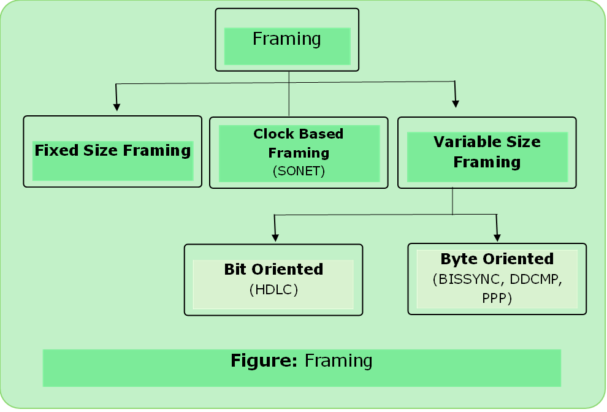

# Framing

- It packs bits into frames, so each frame is distinguishable.
- $$\text{Frame} = \text{Header} + \text{Network Layer PDU} + \text{Trailer}$$
- In packet switched networks, frames are exchange between nodes not bits streams.
- **Bits flow between adaptors, frames flow between nodes.**
- If sender wants to transmit it asks adapter to transmit a frame from memory. This results in a sequence of bits being sent over the link. Other side adapter collects it and puts it in memory.

### 1. Fixed Size Framing

- size of the frame is fixed and frame length acts as delimiter of the frame.

---

### 2. Variable Size Framing

- Size of each frame to be transmitted may be different. Additional mechanisms are kept to mark the end and start of the next frame.

#### Bit Oriented Approach

- It simply vies the frame as a collection of bits.
- In this approach, data is transmitted as a sequence of bits that can be interpreted in the upper layer both as text or multimedia data.
- Protocol- [HDLC](../computer_network/hdlc.md) 

#### Byte Oriented Approach

- Oldest approach of framing
- Each frame is viewed as a collection of bytes (characters) rather than bits.
- Protocol- [BISYNC](../computer_network/bisync.md), [DDCMP](../computer_network/ddcmp.md), [PPP](../computer_network/ppp.md)

#### Clock Based Framing

- Third approach to framing is the clock based framing.
- Protocol- SONET (Synchronous Optical Network)

