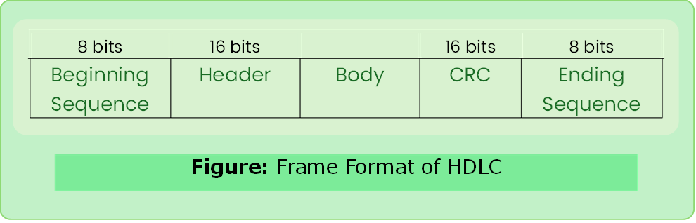

# HDLC

- High Level Data Link Control
- Developed by IBM as SDLC(Synchronous)later it is standardized by ISO as HDLC.
- Bit Oriented Protocol 

### Frame Format

#### Beginning & Ending Sequence
- `01111110`
- Transmitted even when there is not transmission is happening in between sender and receiver this keeps their clock synchronized.

#### Types of HDLC Frames

1. I-Frame: Information (1st bit `0`)
2. S-Frame: Supervisory (1st two bits `10`)
3. U-Frame: Un-numbered (1st two bits `11`)

#### Utility
1. WAN connections
2. Telecommunication networks
---
### Bit Stuffing
- If payload also includes beginning sequence then after (`11111`)’s `0` is stuffed.

