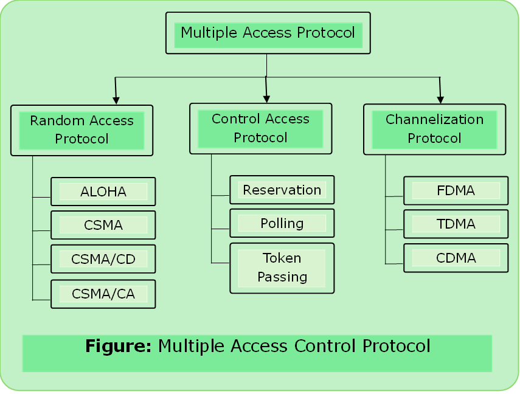

# Multiple Access Protocols

- If dedicated link between sender and receiver -> all sufficient
- No dedicated link between then multiple stations can access the channel simultaneously.
- Decrease Collision & Avoid crosstalk.

### Random Access Protocol

- All stations have same priority. Each station can send data depending on medium’s (state) idle or busy.
- Each station has right to the medium without being controlled by any other station.
- If more than one node tries to send, collision happens.

 - When to send 
 - What if busy
 - How to know delivery is successful or failed
 - What to do if access conflict

#### Example of Random Access Protocol
1. [ALOHA](../computer_network/aloha.md)
2. [CSMA](../computer_network/csma.md)
3. [CSMA/CA](../computer_network/csma.md#csmaca)
4. [CSMA/CD](../computer_network/csma.md#csmacd)

### Control Access Protocol
- The stations consult one another to find which station has the right to send.
- A station can not send unless it has been authorized by other stations

#### Example of Control Access Protocol

1. [Reservation](../computer_network/reservation.md)
2. [Polling](../computer_network/polling.md)
3. [Token Passing](../computer_network/token_passing.md)

### [Channelization Protocol](../computer_network/channelization_protocol.md)

#### Example of Channelization Protocol
1. [FDMA](../computer_network/channelization_protocol.md#fdma)
2. [TDMA](..//computer_network/channelization_protocol.md#tdma)
3. [CDMA](..//computer_network/channelization_protocol.md#cdma)
