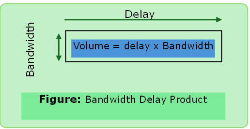
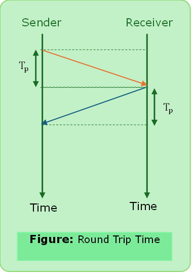

# Network Performance

### Bandwidth

#### Informal 
- Maximum amount of data that can be transmitted per second.

#### Formal:
- The bandwidth of a network is given by the number of bits that can be transmitted over the network in certain period of time.

#### Unit
- `bps` (bits per second)
- **Bandwidth in `Hz`** 
 - A range of frequencies used to transmit signals which is measured in `Hz`.

##### Formula
$$\text{Bandwidth } = \text{ capacity}$$

---

### Throughput

#### Informal
- Actual amount of data that passes through the medium.
#### Formal
- The throughput is a measure of how fast we can actually send data through a network.
#### Unit
- bps or Hz

##### Formula

$$\text{Throughput } < \text{ Bandwidth}$$

---

### Latency
- The latency defines how long it takes for an entire message to completely arrive at the destination from the time the first bit is sent out from the source.

##### Formula
$$\text{Latency } = \text{ Transmission Delay } + \text{Propagation Delay } + \text{Queuing Delay } + \text{ Processing Delay }$$

#### Components

##### Transmission Delay
- Time it takes to place the complete data packet on the transmission medium.

##### Formula

$$\text{Transmission Delay }\text{T}_\text{t} = \frac{\text{Message Size}}{Bandwidth}$$

#### Propagation Delay:
- Time it takes a bit to go from sender to receiver.
- The propagation time is calculated by dividing the distance by the propagation speed.

##### Formula

$$\text{Propagation Delay }\text{T}_\text{p} = \frac{\text{Distance}}{Propagation Speed}$$

##### [Solved Problems Propagation Delay](../computer_network/solved_problems_cn.md#problem-3)

#### Queuing Delay:
- The time needed for each intermediate or end device to hold the message before it can be processed.
- The queuing time is not fixed. It changes with the load imposed on the network.
- Heavy traffic on the network causes queuing time increment.

#### Processing Delay:
Time the node takes to process the message.

---

### Bandwidth-Delay Product

- The bandwidth delay product defines the number of bits that can fill the link.
- It is the capacity of the link.

#### [Solved Problems Bandwidth Delay Product](../computer_network/solved_problems_cn.md#problem-2)

---

### Round Trip Time/Delay
- It is the length of time it takes for a signal to be sent 
- the length of time it takes for an `ack` of that signal to be received.

##### Formula

$$ \text{RTT} \cong 2 \times \text{T}_\text{p} $$

---

