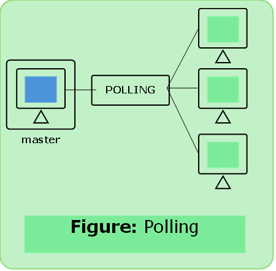

# Polling

- One node is designated as a master (primary) node.
- The master node polls each nodes in a R-R (Round Rabin) fashion.
- The master node can determine when a node finished sending its frame by observing the lack of a signal on the channel.
- **Eliminates collision**
- Drawback: **polling delay**, what if master node fails

### Polling Functions

#### Pull Function
- if master wants to receive data, it asks the secondarys if they have anything to send.

#### Select Function
- If primary wants to send data, it tells the secondary to get ready to receive.

$$
\text{Efficiency } = \bigg(\frac{\text{T}_\text{t}}{\text{T}_\text{t} + \text{T}_\text{polling}}\bigg)
$$

