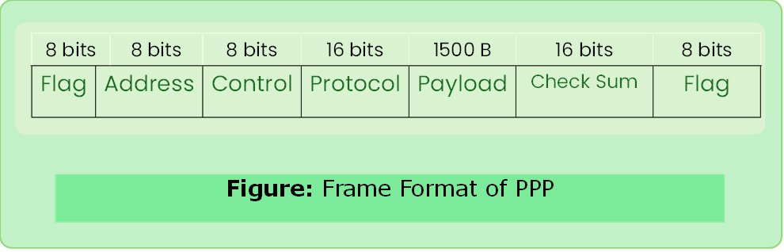

# PPP

- Point-to-Point Protocol

- This is WAN protocol (router- router) and which is commonly run over internet links.
- It is widely used in broadband communications having heavy loads and high speed.
- Used to transmit multiprotocol data between two directly connected (p2p) computers.

### Header Format

- Flag- `01111110`
- Control- constant value `11111110`

