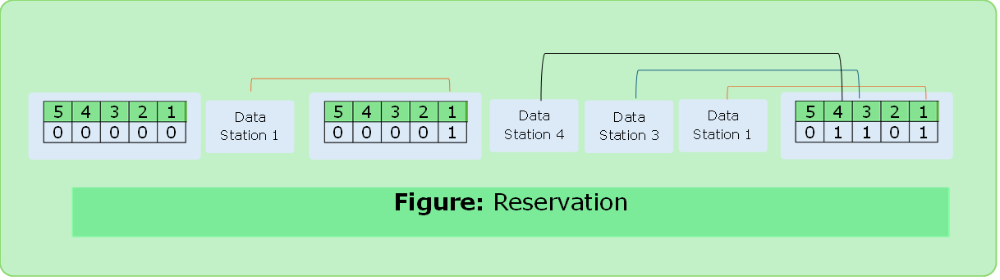

# Reservation

- A station need to make a reservation before sending data.
- In each interval, a reservation frame precedes the data frame in that interval.
- If there are `N` systems, there are exactly `N` reservation.
- Each mini slot belongs to a station.
- When station needs to send data it makes reservation in its own mini slot.
- Those who made reservation can send their data frames.

