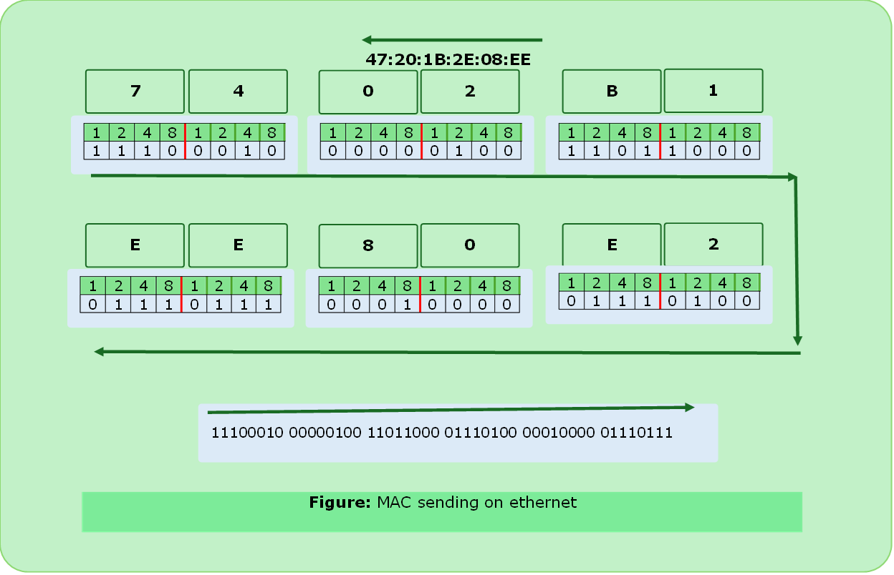

# Ethernet Solved Problems

### Problem 1

#### How `47:20:1B:2E:08:EE` is sent on line?

#### Solution

---

### Problem 2

#### `43:7B:6C:DE:10:00` has been as the source address in an ethernet frame? Receiver discarded the frame why?

#### Solution

> In the left most octet that is 43 (hexadecimal) `0100 0011` . LSB is 1 which means that it is an multicast address. Multicast can not be in source address.

---

### Problem 3

#### An ethernet MAC sublayer receives 42 bytes of data from the upper layer. How much bytes of padding needed?

#### Solution

> Minimum length of payload is = 46 bytes
> Hence $46-42 = 4 \text{bytes}$ padding is needed.

---

### Problem 4
#### An ethernet MAC layer receives 1510 bytes data? Can 1 frame needed? If not how many frames are needed? Also calculate useful data to the entire packet for min and max payload?

#### Solution

> First Frame = 1500 bytes
> Second Frame = $10 + 36$(padding) = 46 bytes
> Ratio for first frame = $46/64=71.9\%$
> Ratio for second frame = $1500/1518=98.8\%$

---

### Problem 5
#### `10base5` is 10 Mbps. How long it take to create the smallest frame?

#### Solution
> Length of smallest frame is 64 bytes.
> Time for creation of smallest frame

$$
\begin{aligned}
\text{smallest frame} &= \frac{64 \times 8 \text{ bits}}{10 \times 10^6 \text{ bits/second}} \\
&= 51.2 \ \mu\text{s}
\end{aligned}
$$

---

### Problem 6

#### Determine the max length of the cable(in km) for transmitting data at a rate of 500 Mbps in an ethernet LAN with frames of size 10,000 bits. Assume signal speed in cable to be 2,00,000 km/s.

##### Formula

$$
\begin{aligned} 
\text{Transmission Time }\text{TT} &\ge \text{RTT of }1 \text{bit} \\
\frac{\text{Message Size}}{\text{Bandwidth}} &\ge 2 \times \frac{\text{Distance}}{\text{Speed}} \\
\text{Transmission Time} &\ge 2 \times \text{Propagation Delay} 
\end{aligned}
$$

#### Solution
> bandwidth = 500 Mbps
> Frame size = 10,000 bits
> Propagation Time = $2×10^{5} \text{ km/s}$

$$
\begin{aligned}

\frac{10,000}{500 \times 10^{6}} &\ge 2 \times \frac{\text{distance}}{2 \times 10^{5}\text{ km/s}} \\
2 \times 10^{-5} &\ge \frac{\text{distance}}{10^{5}} \\
\text{distance} &\le 2\text{ km} \\
\text{max distance} &= 2\text{ km}
\end{aligned}
$$

---

### Problem 7
#### A network with CSMA/CD protocol in MAC layer is running at 1 Gbps over 1 km cable with no repeaters. The signal speed in cable is 2×10^8 m/sec. The min. frame size for this network?

##### Formula

$$ \frac{\text{Message Size}}{\text{Bandwidth}} \ge 2 \times \frac{\text{Distance}}{\text{Speed}} $$

#### Solution

> Bandwidth = 1 Gbps
> Distance = 1 km
> Propagation Speed = 2×10^8 m/sec
> We know that,

$$
\begin{aligned}

\frac{\text{message size}}{1 \times 10^{6}\text{ bits/second}} &\ge 2 \times \frac{\text{distance}}{2 \times 10^{8}\text{ m/s}} \times 10^{3} \text{ m} \\

\text{message size} &\ge 10^{4}\text{ bits} \\
\text{Min Frame Size} &= 10^{4}\text{ bits}
\end{aligned}
$$

