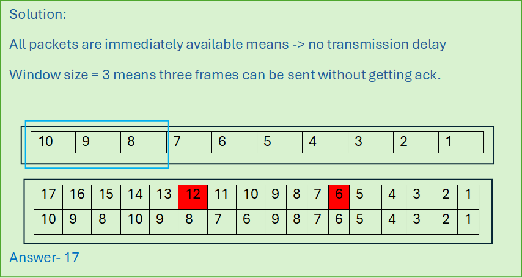
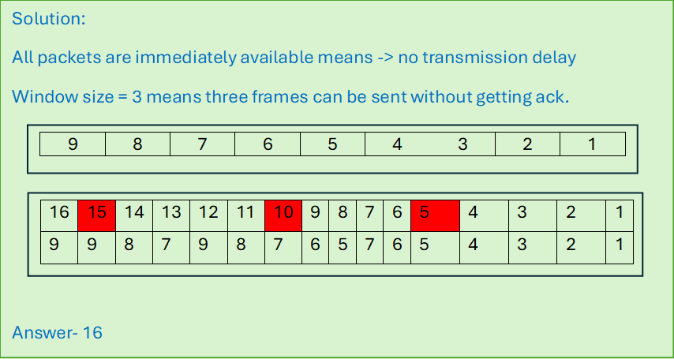
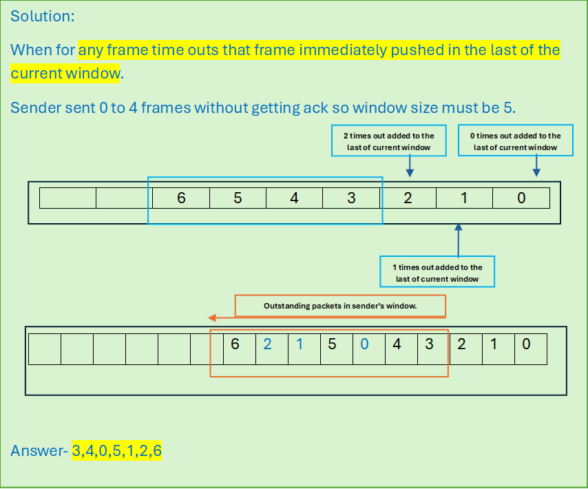
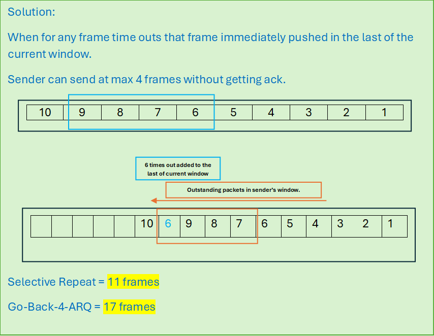

# Flow Control Solved Problems

### Problem 1

#### Host `A` wants to send 10 frames to `B`. The host agreed to go with `Go Back 4`. How many number of frames are transmitted by `A` if every 6th frame is lost?

#### [Solution](../computer_network/flow_control.md#stop--wait-arq)

> All packets are immediately available means -> no transmission delay
> Window size = 3 means three frames can be sent without getting ack.

> 

---
### Problem 2

#### Station `A` needs to send a message consisting of 9 packets to station `B` using a sliding window (w.s. 3) and `go-back-n` error control. All packets are immediately available for transmission. If every 5th packet gets lost and (`ack`’s) from `B` never lost, then what is the number of packets `A` will transmit for sending the message.

#### [Solution](../computer_network/flow_control.md#go-back-n-arq)

> All packets are immediately available means -> no transmission delay
> Window size = 3 means three frames can be sent without getting ack.

> 

---

### Problem 3

#### In `Selective Repeat` protocol, suppose frames through 0 to 4 have been transmitted. Now, imagine that 0 times out 5 (a new frame is transmitted) 1 time out 2 times out and 6 (another frame is transmitted). At this point, what will be the outstanding packet’s in senders window?

#### Solution

> When for **any frame time outs that frame immediately pushed in the last of the current window**.
> Sender sent 0 to 4 frames without getting ack so window size must be 5.

> 

---
### Problem 4
#### Host `A` agreed `selective ARQ-SR`. 10 frames are to be sent. If every 6th frame is lost. How many frames are sent? Compare it with `Go Back 4 ARQ`.

#### Solution

> When for any frame time outs that frame immediately pushed in the last of the current window.
> Sender can send at max 4 frames without getting ack.

---

### Problem 5
#### Station `A` uses 32 bytes packet to transmit message to station `B` using a sliding window protocol. The round-trip delay between `A` and `B` is 80 ms and bottleneck bandwidth on the path `A` to `B` is 128 kbps. What is the optimal window size `A` should use?

##### Formula

$$\text{Optimal Window Size (in frames)} = \frac{\text{BDP}}{\text{Frame Size}}$$

#### Solution

$$
\begin{aligned}
\text{Bandwidth Delay Product (BDP)} &= 128 \text{ kbps} \times 80 \text{ ms} \\
&= \left(128 \times 10^{3} \text{ bits/s}\right) \times \left(80 \times 10^{-3} \text{ s}\right) \\
&= 128 \times 80 \text{ bits} \\
&= 10{,}240 \text{ bits} \\[1ex]
\text{Optimal Window Size (in frames)} &= \frac{\text{BDP}}{\text{Frame Size}} \\
&= \frac{128 \times 80 \text{ bits}}{32 \times 8 \text{ bits}} \\
\text{w.s.} &= 40 \text{ frames}
\end{aligned}
$$

---

### Problem 6
#### `M` and `N` are `L` km apart. All frames are `k` bits long. Propagation Time/km is `t` seconds. `R` bits/second channel capacity. There is no processing delay. The min no of bits for the sequence no field in a frame for max utilization when sliding window is used.

#### Solution

$$
\begin{aligned}
\text{Distance} &= L \text{ km} \\
\text{Propagation Delay } (T_p) &= \frac{L}{V} \text{ seconds} \\
\text{Round-Trip Time (RTT)} &= 2 \times T_p = \frac{2L}{V} \text{ seconds} \\
\text{Bandwidth} &= R \text{ bps} \\
\text{Bandwidth-Delay Product (BDP)} &= \text{RTT} \times R = \frac{2L \cdot R}{V} \text{ bits} \\
\text{Optimal Window Size } (w.s.) &= \frac{\text{BDP}}{\text{Frame Size}} = \frac{2L \cdot R}{V \cdot K} \text{ frames}
\end{aligned}
$$

##### Formula

$$\text{Minimum bits required for the sequence number is } = \log_2\bigg(\frac{2\times\text{L}\times\text{T}\times\text{R}}{\text{k}}\bigg)$$

