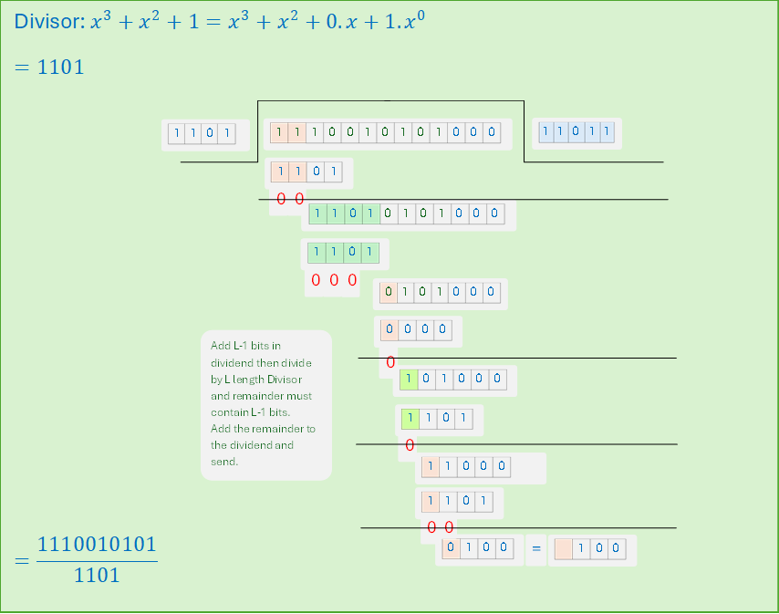

# CN Solved Problems

### Problem 1 

#### Find the CRC for `1110010101` with the divisor $x^{2} + x^{3} + 1$

#### [Solution](../computer_network/error_control.md#crc-cyclic-redundancy-check)

##### Formula

$$\text{Dividend} = \text{Dividend} \times \text{quotient} + \text{remainder}$$

$$
\begin{aligned}
\text{Divisor } x^{3} + x^{2} + 1 &= x^{3} + x^{2} + 0 \times x + 1 \times x^{0} \\
\text{Divisor} &= 1101 \\
\text{Dividend} &= \text{Dividend} \times \text{quotient} + \text{remainder} \\
\text{remainder CRC} &= \frac{1110010101}{1101} \\
\text{remainder CRC} &= 100
\end{aligned}
$$

---

---

### Problem 2
#### Capacity of channel is 512 Kbps and round-trip delay is 1000 ms. Find Bandwidth Dealy Product.

#### Solution

$$
\begin{aligned}
\text{Bandwidth} &= \text{Capacity} = 512 \text{ Kbps} \\
\text{Delay} &= \text{Round-Trip Delay} \\
\text{Bandwidth Delay Product} &= \text{Bandwidth} \times \text{Delay} \\
&= 512 \text{ Kbps} \times 1000 \text{ ms} \\
&= 512 \times 10^3 \text{ bps} \times 1000 \times 10^{-3} \text{ s} \\
&= 512 \times 10^3 \text{ bits} \\
&= 512 \text{ Kb} \\
&= \frac{512}{8} \text{ KB} \\
&= 64 \text{ KB}
\end{aligned}
$$

---

#### Problem 3
##### Find Propagation Time. If $\text{distance }= 12,000\text{ km}$ and $\text{propagation speed } 2.4\times 10^{8} \text{ m/s}$ .

#### Solution

$$
\begin{aligned}
\text{Propagation Time } (T_P) &= \frac{\text{Distance}}{\text{Speed}} \\
T_P &= \frac{12000}{2.4 \times 10^8} \text{ s} \\
&= \frac{12}{2.4} \times \frac{10^3}{10^8} \times 10^3 \text{ s} \\
&= 5 \times 10^{-2} \text{ s} \\
&= 50 \text{ ms}
\end{aligned}
$$

---

