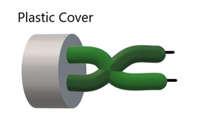
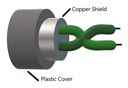

# Twisted Pair

- Signal: Electromagnetic Signal
- Connectors: RJ-45 (Registered Jack)
- Ethernet Cables
- EMI (Electromagnetic Interference), RFI (Radio Frequency Interference)

### UTP

- No additional shielding
- More sensitive to EMI and RFI
- Not suitable for long distance
- EMI and RFI. This can be minimized be increasing the number of twists per wire pair. 
- Examples:- cat 3, 5, 5e, 6

#### Crosstalk 
- UTP don’t have shielding to counter effect of 
- **signal waves from one cable leak into other is called crosstalk.**

### STP

- Metal shielding around each wire pair and around entire - cable
- Less sensitive to EMI and RFI.
- Better for long distance
- Examples: cat 6, 6a, 7, 8
- No [crosstalk](#crosstalk) in STP

