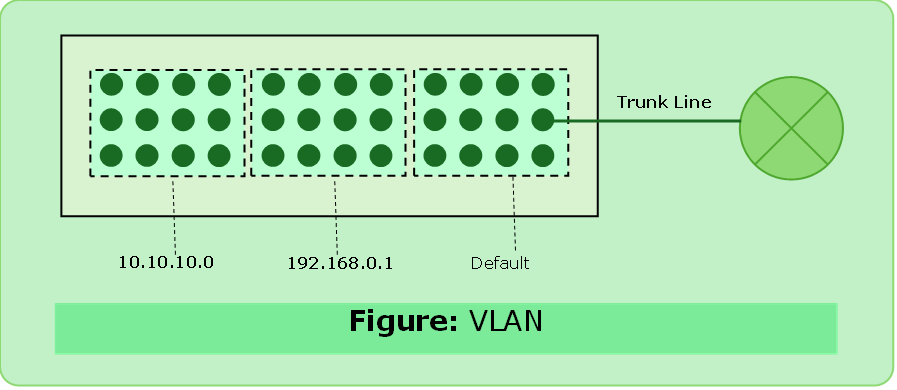
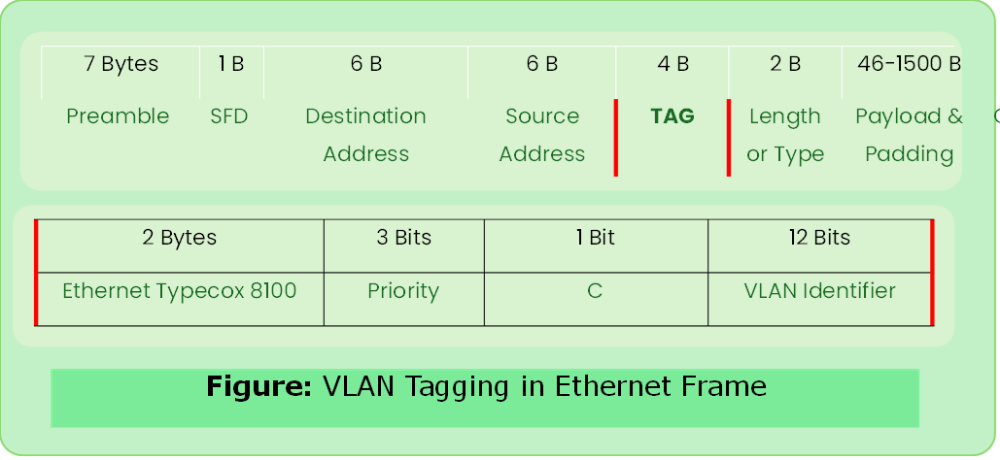

# VLAN

- Logical partition of a layer-2 (device- switch) network.
- Each VLAN is a broadcast domain, usually with its own network ip network.
- VLANs are mutually isolated (hosts are unaware of existence of VLANs) & packets can only pass between them via a router.

### Advantags of VLAN
- security
- shrink broadcast domains

### Types
- Data VLAN
- Default VLAN
- Native VLAN
- Management VLAN
- Voice VLAN

---

### VLAN Frame Tagging

- Process of adding (switches) a VLAN identifier header to the frame. (**IEEE 802.1Q**)
- Used to transmit multiple VLAN frames through a trunk line. (line connecting router and switch with VLANs)
- Switches add tag while placing the packet on the trunk line and remove it when placing it on non-trunk line.

---

### Spanning Tree Protocol (IEEE 802.1D)

#### Redundancy
- access network resources, despite path disruption.
- Improves reliability, availability
- Single connection means single point of failure.

- STP was created to prevent loops.
- Switches send probes (Bridge Protocol Data Unit- BPDU) into the network to discover loops in every 2 seconds.
- BPDU elects the root bridge and best path to reach root bridge, it also block redundant links.

#### Election of Root Bridge

- Lowest bridge id
- If tie on first bridge with lowest mac address will become root bridge.

#### Port Roles

1. Root Port -> used to reach root bridge
2. Designated Port -> forwarding port, one per link
3. Blocking/Non-designate Port -> loops

- STP ensures that there is only one logical path between all destinations on the network.
- A port is blocked. Only BPDU will be allowed.
- If this redundant link is ever needed it will be unblocked by STP.

