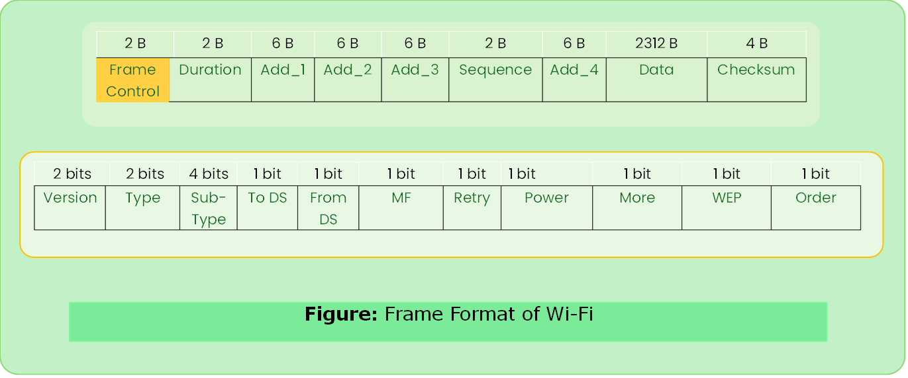
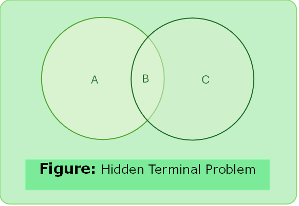
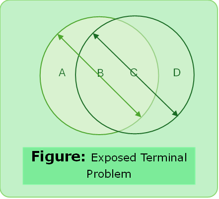

# Wi-Fi

- IEEE 802.11 (legacy) -> 2.4 GHz -> 2 Mbps
- IEEE 802.11ax -> 5GHz -> 2.4 Gbps
- 5 GHz Radio Band (23 overlapping channels)
- 2.4 GHz frequency band (3 non-overlapping channels)
- CSMA/CA
- Two Modes- Infrastructure, Ad-hoc & Wi-Fi direct.

### Distribution System
- Some nodes are connected to a wired network infrastructure. Access Point (AP) are connected to each other called distribution system.
- This system runs on Layer-2. 
- Each node associates itself with one access point only.


#### Active Scanning
- Node is actively scanning.

```text
Step 1: Node sends probe frame
Step 2: All APs reply with probe response frame.
Step 3: Node selects one AP & sends Association Req. Frame.
Step 4: AP replies with Association Response Frame.
```

#### Passive Scanning

- APs also periodically send a Beacon Frame that advertises the capabilities of AP these include transmission rate supported by the AP. 


---

### Wi-Fi Frame Format



#### Frame Control
- 2 Byte starting field composed of 11 subfields.

1. Protocol Version 
- It has been included to allow future compatibility. Set to 00.
2. Type
- Specifies whether frame is data, control or management frame.
3. Subtype
- Specifies whether the field is a RTS or CTS control frame. For regular frame the value is 0000.
4. To DS
- Indicates whether the frame is going to the access point. (Distribution System)
5. From DS
- Indicates whether frame is coming from the AP. (Distribution System)
6. MF: Set to 1 indicates that more fragments would follow up.
7. Retry
- Bit is set to 1 specifies a retransmission of a previous frame.
8. Pwr Management
- A single bit subfield indicating that the sender is adopting to power- save mode.
9. More Data
- Indicates that Sender has further data frames for the receiver.
10. WEP
- Indicates that whether frame is encrypted.
11. Order
- It shows to the receiver that to the higher layers the frame should be in an ordered sequence.

---

#### Duration
- It specifies the time period for which the frame and its ack occupy the channel.

#### Add1, Add2, Add3, Add4

| To DS | From DS | Add1 (dest.) | Add2 (source.) | Add3 (final dest.) | Add4 (original source) | Note                    |
| --------- | ----------- | ----------------------- | ------------------------- | ----------------------------- | --------------------------------- | ---------------------------- |
| 0         | 0           | Destination             | Source                    | BSSID                         | N/A                               | Not using AP infrastructure. |
| 0         | 1           | Destination             | Sending AP                | Source                        | N/A                               | AP -> Client                 |
| 1         | 0           | Receiving AP            | Source                    | Destination                   | N/A                               | Client -> AP                 |
| 1         | 1           | Receiving AP            | Sending AP                | Destination                   | Source                            | AP-> AP                      |

---

#### Sequence

- Stores frame numbers. It detects duplicate frames, determines order of frames for higher layers.
 - First 4 bits provides identification to the fragment & the rest of 12 bits contain the sequence number that increments with each transmission.

#### Data
- Maximum size 2312 Bytes.

#### Checksum
- for error detection.

---

### [Hidden Terminal Problem](#hidden-terminal-solution)

- Suppose A and C both wants to communicate with B.
- A and C are unaware of each other.
- They will send frames and their frames will collide at C and both (A and B) are unaware of collision.
- A and C are called Hidden Terminals.



---

### [Exposed Terminal Problem](#exposed-terminal-solution)

- Suppose B is sending to A. Node C is aware of this communication it would be mistake for C to conclude that it cannot transmit to anyone just because it can hears B’s communication.
- Suppose C wants to communicate with D. This should not be a problem since C’s transmission to D will not interfere with A’s ability to receive from B.



---

### MACA
- Media Access Collision Avoidance Solution

- Before sender actually transmits any data, sender and receiver exchange control frames.
- **Sender sends RTS** (Ready to Send) frame to the receiver.
 - RTS includes a field that indicates how long the sender wants to hold the medium and size of data.

- **Receiver replies with a CTS** (Clear to Send) frame.
 - It echoes the length field back to the sender.

#### Hidden Terminal Solution 
- Any node sees CTS it knows that it is near to receiver, and hence must not transmit for the period of time.

#### Exposed Terminal Solution
- Any node sees RTS frame it knows that it is not close to receiver to interfere with it and is free to transmit. 

---

#### MACAW
- Receiver sends ack after successfully receiving a frame.
- All nodes must wait for this ack before trying to transmit.
- If two RTS collide. Sender realized the collision has happened when they do not get CTS frame after a period of time.
- In this case, they wait for a random period of time. (**exponential backoff algorithm**)


